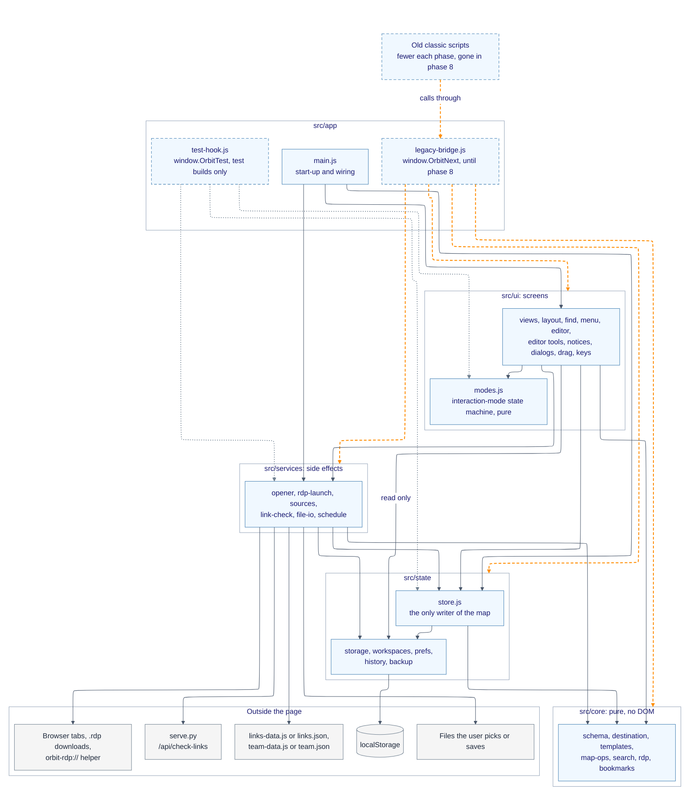
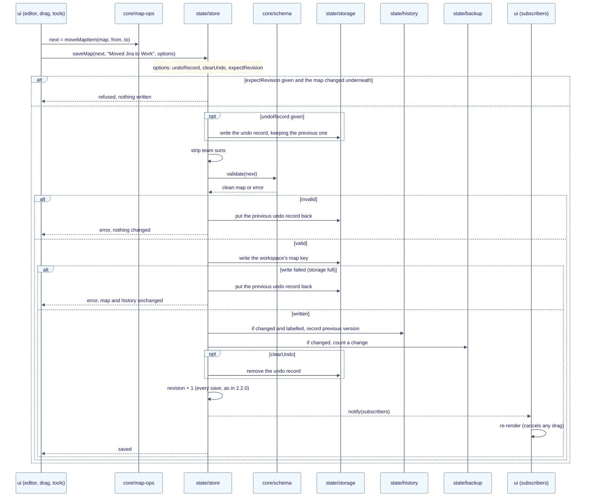

# Orbit rewrite plan (3.0.0)

Status: **planning; no app code changed yet.** Revised 2026-11-20 after three independent plan reviews (see "Review record" at the end).

## Goal

Rebuild Orbit's code so it is easier to change safely, while keeping what the user sees and their saved data the same.

- **Same:** every feature, screen, keyboard shortcut, and saved map. Orbit still opens by double-clicking `index.html`, with no install, server, or account.
- **Different:**
  - Each file is a module that names what it uses.
  - One schema defines the map format.
  - Types are checked before tests run.
  - One store holds app state and is the only writer of the map.

Not in scope: new features, a new look, or a framework.

## Branch rules

- All rewrite work happens on the `rewrite` branch, including this plan. It started from `main` at `d194f43` (2.2.0, tag `v2.2.0`); `main` was merged in again at 2.2.1 (`45d6df0`, tag `v2.2.1`), which is the rollback point. This overrides the usual "commit straight to `main`" rule for rewrite work only.
- **"2.2.0" in this plan means the current 2.x behavior.** 2.2.1 changed only Reset in workspaces other than Main (see "2.2.0 bug found by the review"); everything else, including `storage.js` and `rdp.js` for the oracle, is unchanged.
- **Nothing from the rewrite goes to `main`** until the user approves the final merge.
- **Feature freeze:** no new features on `main` while the rewrite runs.
- **Fixes to 2.x** still go to `main` under the normal rule. The same day:
  1. Merge `main` into `rewrite`.
  2. Apply the fix to the new module too, if that code has already moved.
  3. Add the failing test to both the browser suite and, where it applies, the node suite.
- Push the branch with `git push main rewrite`. (The remote is named `main`.)
- The change cycle applies to each phase, on the branch: local tests, Edge on the VM, fix, docs, then commit and push to `rewrite`. A phase with no change on screen records "Edge: N/A, no browser-visible change" instead of running Edge.
- **Every bug gets a failing test first.** Write a test that reproduces the bug, see it fail, then fix it.
- **Only the Lead edits this plan.**
- **The user sets the pace.** No phase starts without the user's go-ahead.

## Decisions

| Question | Choice | Why |
| --- | --- | --- |
| Language | JavaScript with JSDoc types, checked by `tsc --noEmit` (`checkJs`, `strict`) | Types catch wrong fields and indices, and the source still runs as plain JavaScript |
| Modules | ES modules in `src/`, bundled by esbuild into one `orbit.js` (IIFE) | Chromium won't load modules from `file://`; a single bundled file works from disk |
| Bundle in git | Yes, commit `orbit.js` (as with `links-data.js`). esbuild is pinned to an exact version with a committed lockfile. `.gitattributes` sets `orbit.js text eol=lf`. A test checks that the bundle matches a fresh build. | Double-click still works without installing anything, and the check is stable across machines |
| Source map | A linked `orbit.js.map`, generated by `npm run watch` only and not committed | Keeps the bundle check simple; a release zip without it only costs a DevTools warning |
| Test and release builds | Two outputs from the same source: the committed release bundle `orbit.js` (no test hook) and an uncommitted test bundle `orbit.test.js` (with the hook). Browser suites run the test bundle in fixture copies; the release bundle has its own smoke check (see "Builds and what tests run") | Tests can reach the hook without shipping it, and the shipped file is still tested |
| Map format | One schema in `src/core/schema.js` that drives validation, types, and the docs, held to 2.2.0's behavior by a differential test | Today four validators repeat the same rules; a stricter schema would silently drop user maps |
| State | One store (`src/state/store.js`) that the screens subscribe to | Replaces 20 files reassigning shared globals |
| Migration path | A strangler: the bundle and the old scripts run together, and old functions forward to new ones phase by phase (see "Coexistence") | The app works and is tested at the end of every phase |
| Tests | Keep the Python Playwright suites, and add a `window.OrbitTest` hook | The suites check what's on screen, so they still apply; their direct use of globals moves to the hook |
| Version | `APP_VERSION` moves to `src/app/version.js`; the release steps in `README-distribute.md` read it from there | The release `sed` lines read `app.js` today |
| Helpers | `serve.py`, `sync.py`, and `windows/*.ps1` stay as they are | They work and aren't part of the problem |
| Tooling | Node only for development: esbuild, TypeScript, fast-check | Users never need Node |
| Test approach | Tests first for `core/`, `state/`, `services/`, and `ui/modes.js`; property-based tests for map operations; a differential test against 2.2.0; a state-machine model for interaction modes (see "How we test") | Fast, exact tests where the logic lives; random inputs find edge cases nobody writes by hand |

## Coexistence (strangler)

The old classic scripts and the new bundle run in the same page until phase 8, so Orbit works, and is tested, at the end of every phase.

- **Load order in `index.html`:**
  1. `links-data.js` and the optional `team-data.js` (synchronous, as today).
  2. `orbit.js`, synchronous and not `defer`.
  3. The old scripts that are still in use, in their current order.
- **The bridge.** `orbit.js` publishes `window.OrbitNext` from `src/app/legacy-bridge.js`. During coexistence it does not run its own start-up; the old `app.js` `init` still does.
- **Each phase ends by making the old functions thin wrappers** around the new ones, so the browser suites exercise new code from phase 2 on. For example, `function destinationKey(item) { return OrbitNext.core.destinationKey(item); }`. Wrappers look up `OrbitNext` when called, never at load time.
- **One writer from phase 3.** The old `saveMap` calls `store.saveMap`, and a store subscriber copies the result back into the old globals (`groups`, `routines`, `rdpPresets`, `mapRevision`, `activeMapSource`), then runs the old `countDestinations` and `render`. Old code that writes `groups` directly (`setTeamSunHidden`, Reset, workspace switch) moves to store calls in the same phase.
- **Screens move whole (phases 5–7).** When a screen's code moves, its old script is removed from `index.html` and from `APP_SCRIPTS` in `tests/helpers.py`. The bridge temporarily re-exports any names the remaining old scripts still call (e.g. `tagPath`, `fitOrbitSizes`, `render`).
- **Each phase's "done when"** lists which old files are no longer loaded.
- **Phase 8** deletes the bridge, the last wrappers, and the remaining old files, and `main.js` runs start-up.

| End of phase | Old scripts still loaded |
| --- | --- |
| 1 | All 20 (bundle loaded, only the test hook in it) |
| 2 | All 20; core functions forward to `OrbitNext.core` |
| 3 | All 20; `saveMap` and storage forward to the store |
| 4 | All 20; opener, sources, and file I/O forward to services |
| 4b | All 20; mode flags deleted, old code reads and writes `ui/modes.js` |
| 5 | Without `render.js` and `palette.js` |
| 6a | Also without `menu.js`, `variables.js`, `sharing.js` (notices), `favorites.js` |
| 6b | Also without `editor.js`, `editor-page.js`, `tools.js`, `routines.js`, `workspaces.js`, `presets.js`, `team.js` |
| 7 | Also without `drag.js`, `keys.js` |
| 8 | None; `storage.js`, `rdp.js`, `app.js` and the bridge removed |

The table is the target. A phase may move a file earlier or later, and records it here.

## Architecture

Arrows point from a module to what it uses. Dependencies point down only: app → ui → services → state → core. A module may skip layers going down (a screen may read `state/` or call `core/` directly) but never imports upward. Modules inside `ui/` may use each other as long as there's no cycle. `core` touches no browser APIs, so it can be tested under `node --test`. Dotted arrows are temporary or test-only. The store gets the bundled map from `main.js` at start-up (it can't import `services/sources.js`, which is a layer above it), and uses it for Reset and for Main's fallback.



**Legend:** solid arrows mean "uses" and point down the layers. Dashed orange arrows are the temporary bridge that exists only until phase 8. Dotted gray arrows exist only in test builds. A dashed border marks a module that is removed in phase 8 or never ships. Arrows to a whole layer box mean the bridge re-exports from that layer, not that it uses every module in it.

Each module's own dependencies:

| Module | Uses |
| --- | --- |
| **app/main.js** | `services/sources`, `state/store`, `ui/views`, `ui/keys`, `ui/notices`, `ui/modes` |
| **ui/views** (Galaxy, System, list, click tracking, Shift+click) | `state/store`, `state/prefs`, `ui/layout`, `ui/dialogs`, `ui/menu`, `ui/editor`, `ui/modes`, `services/opener`, `services/rdp-launch`, `core/search` |
| **ui/layout** (`fitOrbitSizes`, moon fan) | nothing (DOM measuring only) |
| **ui/find** (Quick find, palette) | `state/store`, `ui/dialogs`, `ui/editor`, `ui/modes`, `services/opener`, `core/search` |
| **ui/menu** (Settings, Help, About, workspace switch) | `state/store`, `state/prefs`, `ui/editor`, `ui/modes` |
| **ui/editor** (workspace page, tree, forms, Quick add, import/export, reset) | `state/store`, `ui/editor/tools`, `ui/dialogs`, `services/file-io`, `core/schema`, `core/map-ops` |
| **ui/editor/tools** (history, duplicates, link check, imports, bulk RDP, presets, routines, packs, workspaces, team) | `state/store`, `state/history` (read), `services/link-check`, `services/file-io`, `core/schema`, `core/map-ops`, `core/rdp`, `core/bookmarks` |
| **ui/notices** (routine offer, backup, team updates, open-all report, removal undo, storage warning) | `state/store`, `state/prefs`, `state/backup`, `ui/modes`, `services/schedule`, `services/opener`, `services/file-io` |
| **ui/dialogs** (placeholder form, confirm) | `state/prefs`, `ui/modes`, `core/templates` |
| **ui/drag** (Edit mode, pointer drag, tray, drag undo) | `state/store`, `ui/editor`, `ui/modes`, `core/map-ops` |
| **ui/keys** (focus trap, Escape, arrows) | `ui/views`, `ui/find`, `ui/menu`, `ui/drag`, `ui/modes` |
| **ui/modes** | nothing (pure) |
| **services/opener** | `state/store`, `state/prefs`, `services/rdp-launch`, `core/templates`, `core/destination`; opens browser tabs |
| **services/rdp-launch** | `core/rdp`; `.rdp` downloads and `orbit-rdp://` URLs |
| **services/sources** | `core/schema`; `links-data.js`/`links.json`, `team-data.js`/`team.json` |
| **services/link-check** | `serve.py` `/api/check-links` |
| **services/file-io** (pick, read, download, bookmark HTML to folder tree, `.rdp` text) | the user's files |
| **services/schedule** (due routines, backup due, team diff, clock) | `state/store`, `state/prefs`, `state/backup`, `core/destination` |
| **state/store** | `state/storage`, `state/workspaces`, `state/history`, `state/backup`, `core/schema`, `core/map-ops` |
| **state/workspaces**, **state/prefs**, **state/history**, **state/backup** | `state/storage` |
| **state/storage** | localStorage |
| **core/schema** | `core/templates`, `core/rdp` |
| **core/map-ops** | `core/schema`, `core/destination` |
| **core/search** | `core/destination` |
| **core/destination**, **core/templates**, **core/rdp**, **core/bookmarks** | nothing |

`scripts/check-layers.mjs` checks the real imports against this table's layer rule. The table is the intent; if the code needs an edge that isn't here, the Lead adds it to the table first.

### Where today's loose state goes

| Today (file) | New home |
| --- | --- |
| `groups`, `routines`, `rdpPresets`, `mapRevision`, `activeMapSource`, `seedData` (`app.js`, `storage.js`) | `state/store.js` |
| `storageWarning` (`storage.js:308`) | `state/store.js` as a load-result field; shown by `ui/notices/` |
| `teamGroups`, `teamSource`, `teamError` (`team.js`) | `services/sources.js` (loading); `state/store.js` (view) |
| `MAP_STORAGE_KEY`, `UNDO_STORAGE_KEY`, `HISTORY_STORAGE_KEY`, `activeWorkspace` | `state/workspaces.js` |
| `linkCheckResults` (`tools.js:143`) | `ui/editor/tools/` (screen-local, not saved) |
| `dragUndo`, drag controller (`drag.js`) | `ui/drag/` |
| `editMode`, `menuOverlay.hidden`, `palette`, `variableDialog`, `findQuery` | `ui/modes.js` |
| Change counter `countChangeForBackup` (`workspaces.js`) | `state/backup.js`; due check in `services/schedule.js` |
| `uniqueSunId` | `core/map-ops.js` |
| `pathsForKey`, `itemAt` (`favorites.js`) | `core/destination.js` (pure, given the map) |
| Click tracking, Shift+click open (`favorites.js:198-217`) | `ui/views/` |
| `undoRemoval` (`app.js:70-100`) | `state/store.js` (`undoRemoval()`), with the button in `ui/notices/` |

### How a change flows

Every edit, drag, import, restore, and reset goes through the store. Nothing else writes the map. Preferences, recents, variables, and team-seen records are written by `state/prefs.js` and are not map writes.



The order matches 2.2.0:

- **Map before history** (`storage.js:328-339`). If storage is full, the map write fails first, so no history entry is recorded for a change that never happened.
- **Undo record first.** It's written before the map and put back if the save fails (`editor.js:162-185`).
- **`expectRevision` is the one change.** It's new in the store (opt-in, used by drag); 2.2.0 checks the revision inside the drag code instead (`drag.js:433-438`).

### Interaction modes

Today these modes are separate flags spread across files: `menuOverlay.hidden`, `editMode`, the drag controller, `palette`, `variableDialog`, `findQuery`, and `location.hash`. Their order of precedence lives in `handleEscape` (`keys.js:33`) and the key handler (`keys.js:161`). In the rewrite they become one pure state machine, `ui/modes.js`, which follows this diagram. The four parts run side by side.

```mermaid
---
config:
  theme: base
  look: classic
  # Rendered under both engines: dagre keeps the four parts side by side in
  # declared order with labels beside their arrows; elk put the overlay part
  # underneath and crowded its labels.
  layout: dagre
  themeVariables:
    darkMode: false
    background: "#ffffff"
    primaryColor: "#f0f8ff"
    primaryTextColor: "#191970"
    primaryBorderColor: "#4682b4"
    textColor: "#191970"
    lineColor: "#475569"
    edgeLabelBackground: "#ffffff"
    clusterBkg: "#ffffff"
    compositeBackground: "#ffffff"
    compositeTitleBackground: "#e2e8f0"
---
%% Orbit's interaction modes: four parts that run side by side.
%% Escape is handled by only one part per press; the order is in the
%% rules below the diagram. Each transition cites 2.2.0 in those notes.
stateDiagram-v2
  direction LR
  [*] --> SG_ORBIT
  %% Concurrent regions: Orbit is in one state of each part at the same time.
  state "Orbit" as SG_ORBIT {
  state "Overlay (at most one)" as SG_OVERLAY {
    state "No overlay" as OVERLAY_NONE
    state "Command palette" as OVERLAY_PALETTE
    state "Placeholder form" as OVERLAY_PLACEHOLDER
    %% The menu's three states are flat, not a nested box: arrows from outside
    %% into a nested box pull its states out of it under both elk and dagre.
    state "Menu: no panel selected" as MENU_NO_PANEL
    state "Menu: Settings, Help, or About" as MENU_PANELS
    state "Menu: link editor" as MENU_EDITOR
    [*] --> OVERLAY_NONE
    OVERLAY_NONE --> OVERLAY_PALETTE: Ctrl/Cmd+K, not in error view
    OVERLAY_NONE --> OVERLAY_PLACEHOLDER: open a placeholder link
    OVERLAY_NONE --> MENU_NO_PANEL: cog
    OVERLAY_NONE --> MENU_EDITOR: editor shortcut
    OVERLAY_PALETTE --> OVERLAY_NONE: Escape or run an entry
    OVERLAY_PALETTE --> OVERLAY_PLACEHOLDER: run a placeholder link
    OVERLAY_PALETTE --> MENU_PANELS: Open Settings or Help
    OVERLAY_PALETTE --> MENU_EDITOR: Edit links, Edit routines, or Add a link
    OVERLAY_PLACEHOLDER --> OVERLAY_NONE: Escape, Open, or Cancel
    MENU_NO_PANEL --> MENU_PANELS: choose a tab
    MENU_PANELS --> MENU_EDITOR: Edit links
    MENU_EDITOR --> MENU_PANELS: back
    MENU_NO_PANEL --> OVERLAY_NONE: close
    MENU_PANELS --> OVERLAY_NONE: close
    MENU_EDITOR --> OVERLAY_NONE: close
  }
  --
  state "Mode" as SG_MODE {
    state "Browsing" as MODE_BROWSING
    state "Edit mode, idle" as MODE_EDIT_IDLE
    state "Item pressed" as MODE_PRESSED
    state "Dragging" as MODE_DRAGGING
    [*] --> MODE_BROWSING
    MODE_BROWSING --> MODE_EDIT_IDLE: Edit mode on
    MODE_EDIT_IDLE --> MODE_PRESSED: pointer down on an item
    MODE_PRESSED --> MODE_DRAGGING: move past the threshold
    MODE_PRESSED --> MODE_EDIT_IDLE: release, Escape, re-render, or overlay opens
    MODE_DRAGGING --> MODE_EDIT_IDLE: drop, Escape, re-render, or overlay opens
    MODE_EDIT_IDLE --> MODE_BROWSING: Edit mode off or Escape
  }
  --
  state "View" as SG_VIEW {
    state "Galaxy" as VIEW_GALAXY
    state "System (one sun)" as VIEW_SYSTEM
    state "Error view" as VIEW_ERROR
    [*] --> VIEW_GALAXY: start-up
    [*] --> VIEW_SYSTEM: start-up with a sun in the address
    [*] --> VIEW_ERROR: start-up, links could not load
    VIEW_GALAXY --> VIEW_SYSTEM: open a sun from the orbit, list, or Quick find
    VIEW_SYSTEM --> VIEW_GALAXY: logo, Escape, list toggle, Return to Galaxy, typing in Quick find, or the sun is gone
  }
  --
  state "Quick find" as SG_FIND {
    state "Empty" as FIND_EMPTY
    state "Filtering" as FIND_FILTERING
    [*] --> FIND_EMPTY
    FIND_EMPTY --> FIND_FILTERING: type
    FIND_FILTERING --> FIND_EMPTY: Escape or clear
  }
  }

  %% Status: the error view is a dead end until the page is reloaded.
  classDef stateTerminal stroke-dasharray:6 4
  class VIEW_ERROR stateTerminal
```



"Close" on a menu state means Escape, the close button, or a page change (`app.js:134`). The four parts are separated by dashed lines inside the Orbit box, which in a state diagram means they run at the same time: at any moment Orbit is in one state of each part. The error view (dashed border) has no way out except reloading the page.

Notes on the diagram:

- **"Menu: Settings, Help, or About"** stands for three sibling tabs. The cog opens the menu with no panel selected (`menu.js:23-25`).
- **The link editor can be entered directly.** "Editor shortcut" means `openEditorAt`, the Edit-bar button, the empty-Galaxy button, Quick add, or a palette command (`editor-page.js:22`, `drag.js:568`, `render.js:790`, `variables.js:127`).
- **Escape appears in several parts, but only one part handles each press.** Which one is decided by the Escape order below, which the diagram can't show.
- **The "Edit links" arrow from the panels** stands for every way into the link editor from a panel, such as the Settings button.
- **List view is a Galaxy preference** (`orbit:galaxy-view`), not a separate view. A sun opened from the list goes to its System. There's no dragging in list view, because list links carry no `data-kind`.

Rules the model makes explicit, each with a `node --test` case in `ui/modes.test.js`:

- **Escape order:**
  1. The open overlay. Only one can be open. The placeholder form handles Escape itself while focus is inside it (`variables.js:66`).
  2. A pressed or dragging item (`drag.js:426`).
  3. Edit mode.
  4. Quick find.
  5. System → Galaxy.

  This matches `handleEscape` (`keys.js:33-55`) and the palette's own handler (`palette.js:150`).
- **What an open overlay blocks:**
  - While the placeholder form is open, every other key is ignored (`keys.js:161`).
  - While the menu is open, Ctrl/Cmd+K and `/` are refused (`palette.js:177`, `keys.js:65`).
  - Ctrl/Cmd+K is also refused in the Error view.
- **A drag never survives:**
  - opening the menu (`menu.js:21`) or the palette (`palette.js:62`)
  - a page change (`app.js:134`)
  - a workspace switch (`workspaces.js:48`)
  - turning Edit mode off (`drag.js:101`)
  - any re-render (`render.js:895`)

  Every store notify re-renders, so every map change cancels a drag.
- **Edit mode stays on when the menu opens.** Only drags are cancelled.
- **Link clicks are paused in Edit mode only inside `#app`** (`drag.js:543-550`):
  - Galaxy, System, and list links open the editor instead.
  - Links in banners, such as team-update notice links (`sharing.js:150`), still open.
  - Palette matches open the editor (`palette.js:53`).
- **When routine offers are checked:**
  - They check only Edit mode (`routines.js:79`).
  - They run at start-up, whenever Edit mode changes (`drag.js:110`), on workspace switch (`workspaces.js:70`), and when the tab becomes visible (`routines.js:113`).
  - They are not re-checked when an overlay closes.

Phase 0 confirms these rules in a browser and records any other differences here.

### Who owns mode state during the migration

Mode state follows the same rule as the map: **one owner at a time**, never two copies kept in step.

| Phases | Owner | `ui/modes.js` |
| --- | --- | --- |
| 0–4 | The old flags, as in 2.2.1 | Built and tested in phase 3, but **not loaded into the page's decisions**: nothing reads or writes it |
| 4b (cut-over) onward | `ui/modes.js` | The only owner. Old code may not keep its own copy of any mode |

**Phase 4b, the cut-over, is one change made by the Lead, not delegated:**

1. **Every old write becomes an event.** Each place that sets a mode today sends an event to `ui/modes.js` instead: `openMenu`/`closeMenu` (`menu.js`), `openPalette`/`closePalette` (`palette.js`), `askForVariables`/`closeVariableDialog` (`variables.js`), `setEditMode` and the drag controller's press, drag, drop, and cancel (`drag.js`), Quick find typing and clearing (`render.js`, `keys.js`), and route changes (`app.js` `hashchange`).
2. **Every old read becomes a query.** Reads of `editMode`, `menuOverlay.hidden`, `palette`, `variableDialog`, and `findQuery` become calls such as `OrbitNext.modes.is('editIdle')`. The `let` flags are deleted, so a missed read fails loudly instead of using a stale copy.
3. **The page shows the mode by subscribing.** What's visible (the menu overlay, the palette, the placeholder form, the Edit bar) is set by one subscriber to `ui/modes.js`, not by the code that sent the event.
4. **`handleEscape` asks `ui/modes.js` for the topmost layer** instead of checking flags in order.
5. **A check proves there's one owner:** a test greps the old scripts and `src/` and fails on any assignment to those names or to `menuOverlay.hidden` outside the subscriber.

After 4b, phases 5–7 move screen code into modules that already use `ui/modes.js`. They don't change who owns the state.

### Rules the structure enforces

- **Core is pure.** Files in `core/` take data and return data, with no `document`, `window`, `localStorage`, `File`, or `DOMParser`. Bookmark HTML and `.rdp` files are read in `services/file-io`, and `core/` gets plain data.
- **One writer of the map.** Only `state/store.js` writes the map key. Its API covers every write that bypasses `saveMap` today:
  - `saveMap(next, label, {undoRecord, clearUndo, expectRevision})`
  - `resetToBundled()`: in Main, removes the saved map; in other workspaces, saves the file data under the workspace's key (2.2.1 behavior, check F27)
  - `undoRemoval()`
  - `setTeamSunHidden()`
  - workspace `add`, `remove`, and `switch`

  Screens never change state themselves; they ask the store and re-render when notified. Screens may read `state/history.js` and `state/prefs.js` directly (to list versions, or to save a preference), but restoring a version and switching, adding, or removing a workspace go through the store.
- **No storage reads at import time.** Modules set up when `main.js` (or the bridge) calls them, so `node --test` can import any module.
- **Team suns keep their place in the numbering.** The page's `data-sun` attributes and `OrbitTest` keep combined indices with team suns first, as today (`render.js:253-258`). `store.view()` converts between a combined index and `{team, index}`. Writes to a team index are refused by `store` at runtime, and the JSDoc types make them a type error.
- **Stubbed browser calls still work.** App code looks up `window.open`, `confirm`, `prompt`, and `Storage.prototype.setItem` when it calls them and never caches them, so test stubs keep working.
- **Opening tabs stays synchronous.** `services/opener.js` calls `window.open` in the same task as the user's click, with no `await` before it, or Edge blocks even the first tab.
- **Layer check.** `scripts/check-layers.mjs` reads esbuild's metafile and fails the build if a file imports from a higher layer (core < state < services < ui < app) or forms a cycle.
- **Browser stubs are swapped through `services`.** `services/schedule.js` owns the clock (`now()`), so tests can set the time.

## Old file → new home

| Today | Goes to |
| --- | --- |
| `storage.js` | `core/schema.js` (validation), `core/destination.js`, `core/templates.js`, `state/storage.js`, `state/prefs.js`, `state/history.js`, `state/store.js` (`saveMap`) |
| `app.js` | `app/main.js`, `app/version.js`, `state/store.js` (state, `undoRemoval`) |
| `rdp.js` | `core/rdp.js` (parse, strip, preset settings, `effectiveRdpProfile(item, presets)`), `services/rdp-launch.js`, `services/file-io.js` (`readRdpText`) |
| `team.js` | `services/sources.js`, `state/store.js` (combined view, hidden suns), `state/prefs.js` (team favorites, hidden) |
| `favorites.js` | `state/prefs.js` (recents), `core/destination.js` (`pathsForKey`, `itemAt`), `services/opener.js`, `ui/views/` (click tracking), `ui/notices/` (open-all report), `ui/dialogs/` (confirm) |
| `render.js` | `ui/views/`, `ui/layout/`, `core/search.js`, `ui/find/` |
| `editor.js`, `editor-page.js` | `ui/editor/`, `core/schema.js` (`orbit-item-v1`) |
| `tools.js` | `core/map-ops.js` (merge, duplicates), `core/bookmarks.js` (tree to suns), `services/file-io.js` (bookmark HTML parsing), `services/link-check.js`, `ui/editor/tools/` |
| `routines.js` | `core/map-ops.js` (`mergeRoutines`), `services/schedule.js` (due), `ui/editor/tools/routines.js`, `ui/notices/` |
| `variables.js` | `core/templates.js`, `state/prefs.js` (saved values), `ui/dialogs/` (placeholder form), `ui/editor/` (Quick add) |
| `workspaces.js` | `state/workspaces.js`, `state/backup.js`, `services/schedule.js` (backup due), `ui/editor/tools/workspaces.js`, `ui/menu/` (switch), `ui/notices/` |
| `sharing.js` | `core/schema.js` (pack), `services/schedule.js` (team diff), `state/prefs.js` (team seen), `ui/editor/tools/packs.js`, `ui/notices/` |
| `presets.js` | `core/rdp.js`, `ui/editor/tools/presets.js` |
| `menu.js` | `ui/menu/` |
| `drag.js` | `core/map-ops.js` (`moveMapItem`), `ui/drag/`, `state/storage.js` (cross-tab `storage` events become the external-change signal) |
| `palette.js` | `ui/find/palette.js` |
| `keys.js` | `ui/keys/`, `ui/modes.js` |
| `styles.css` | Unchanged at first; split per area once the markup is settled |

## Data the rewrite must keep

The rewrite reads all of these exactly as 2.2.0 writes them. Key names and formats stay the same, and any change goes through a numbered migration in `state/storage.js`.

### Storage keys

| Key | Scope | Notes |
| --- | --- | --- |
| `orbit:map:v1` (Main), `orbit:map:v1:<id>` | Per workspace | Personal favorites live on each item, so they are per workspace too |
| `orbit:undo-removal:v1[:<id>]` | Per workspace | Shape `{kind, index, item, label, sunId, planetUrl, planetHost, planetName, planetIndex}` (`app.js:69-93`) |
| `orbit:history:v1[:<id>]` | Per workspace | Entries `{time, label, groups, routines?, rdpPresets?}` (`storage.js:289`), last 20 |
| `orbit:backup:v1` | One key, one entry per workspace | Read and rewritten whole; a removed workspace's entry is deleted |
| `orbit:workspaces:v1`, `orbit:workspace` | Shared | |
| `orbit:recent:v1` | Shared | |
| `orbit:variables:v1` | Shared | Last value of each placeholder |
| `orbit:routine-offered:v1` | Shared, keyed by routine id | Known clash: routines with the same id in two workspaces share one "offered today" mark. Keep as is; record it in the behavior inventory. |
| `orbit:team-favorites`, `orbit:team-hidden`, `orbit:team-seen:v1` | Shared | |
| `orbit:theme`, `orbit:animations`, `orbit:always-show-moons`, `orbit:font-size`, `orbit:rdp-launch`, `orbit:quick-bar`, `orbit:galaxy-view`, `orbit:site-icons`, `orbit:backup-reminders` | Shared | Booleans stored as the strings `'true'`/`'false'`. Theme ids `alabama`/`auburn` (Red/Blue). Unknown values fall back to the default. |

- [ ] Re-run the key grep (`grep -ohE "'orbit:[a-z0-9:-]+'" *.js`, plus any keys built dynamically) before the fixture is captured, and list any new keys here

### Files, URLs, and globals

- [ ] Export JSON (full map, including `routines` and `rdpPresets`)
- [ ] Single-item export `orbit-item-v1` (sun, planet, or moon; `editor.js:229,260`)
- [ ] Link packs `orbit-pack-v1`
- [ ] Bookmark HTML (Edge and Chrome export format)
- [ ] `.rdp` files, UTF-8 and UTF-16, up to 64,000 bytes
- [ ] `links.json` (server mode) and `window.ORBIT_DATA` from `links-data.js` (file mode)
- [ ] Team map:
  - `/team.json` wins over `window.ORBIT_TEAM_DATA`
  - a 404 falls back to it (`team.js:35-44`)
  - the error text shown when loading fails
- [ ] `orbit-rdp://host/?profile=<base64url>` URLs and the content of downloaded `.rdp` files, which the Windows helper reads

### Fixture

The 2.2.0 storage fixture (`tests/fixtures/v2.2-storage.json`):

- It is built by a script (`tests/make_v22_fixture.py`) from synthetic data, never from the user's browser.
- It contains:
  - every key above
  - two workspaces
  - a team map
  - routines and presets
  - placeholder values
  - old-format values (missing optional fields, `'true'` strings)
  - values 2.2.0 rejects
- Every phase from 3 on must load it with nothing lost.

## How we test

| Approach | Where | How |
| --- | --- | --- |
| Existing behavior as the contract | Whole app | The 2.2.1 browser suites (matrix, drag, sizes, pending, features F01–F27) are the acceptance tests. The baseline is 2.2.1, so it includes the fixed Reset (F27), not 2.2.0's bug. A phase is done when the suites it touches pass in Chromium and Edge, with that phase's old scripts removed from `index.html`. |
| Differential test against 2.2.0 | `core/schema.js`, `core/rdp.js`, `core/destination.js` | `tests/oracle/` keeps a frozen copy of 2.2.0's `storage.js` and `rdp.js`, loaded in Node `vm`. For random valid and invalid inputs, the new code must return the same result or the same error message. The copy stays after phase 8. |
| Test-driven development | `core/`, `state/`, `services/`, `ui/modes.js` | For each function: write a `node --test` case from the behavior inventory, see it fail, write the code, then tidy it. Services are tested with fake `window.open`, `fetch`, storage, and clock. |
| Property-based tests (fast-check) | `core/map-ops.js`, `core/schema.js`, `state/store.js` | Generate random maps and operations and check rules that must always hold (listed in phases 2 and 3). |
| State-machine model | `ui/modes.js` | The "Interaction modes" diagram is the model; each transition and rule has a test. |
| Data compatibility | Fixture | Node from phase 2 (validation of the fixture's maps); browser from phase 3 (the fixture loaded into a real page, then compared field by field). |
| After-the-fact checks | Layout, sizing, drag visuals | The sizing (OS) and drag (DD) suites. Writing these tests first would be slow and fragile, so they are not. |

Not used: full model-based engineering tooling (SysML) or code generated from diagrams. Both are too heavy for a project of this size.

### Builds and what tests run

| Build | Command | Output | Committed | Has `window.OrbitTest` |
| --- | --- | --- | --- | --- |
| Release | `npm run build` | `orbit.js` | Yes | No: `define: { ORBIT_TEST: 'false' }` removes the hook code |
| Test | `npm run build:test` | `orbit.test.js` | No (`.gitignore`) | Yes, always on; no URL flag |

Both come from the same `src/` and the same `build.mjs`; only the `ORBIT_TEST` define differs.

- **Browser suites use the test bundle, in fixture copies only.** `write_fixture` in `tests/helpers.py` copies `orbit.test.js` into the fixture folder **under the name `orbit.js`**, so `index.html` is the same file in tests and in release. It fails with a clear message if `orbit.test.js` is missing or older than any file in `src/`. Every runner tests a fixture copy, never the repo folder; `tests/browser_matrix.py`, which loads the repo's `index.html` today (`browser_matrix.py:67`), moves to a fixture copy in phase 1. Edge runs on the VM copy the same fixture folder, so they test the test bundle too.
- **The committed release bundle is tested three ways:**
  1. **It matches its source:** `npm run check:bundle` rebuilds the release bundle into a temporary folder and compares it byte for byte with the committed `orbit.js`.
  2. **It has no test hook:** the release smoke check asserts `window.OrbitTest` is undefined, and a text search of `orbit.js` finds no `OrbitTest`.
  3. **It works:** `tests/release_smoke.py` opens the **repo folder itself** (the committed `orbit.js`, `links-data.js`, and `index.html`) in file and server mode, with no hook, using only clicks and keys. It checks the Galaxy renders the bundled suns, a System opens, Quick find finds a link, Settings opens, and an edit made in Edit links survives a reload; then it clears what it saved.
- **When each runs:**
  - The test bundle is rebuilt before every browser run (the runners call `npm run build:test` if it's stale).
  - `check:bundle` and `release_smoke.py` run at the end of every phase from 1 on, and in phase 9 in Edge on the VM as well.

### Test hook (`window.OrbitTest`)

The hook exists only in the test bundle (see "Builds and what tests run"). Tests use it instead of reaching into app globals. Most of the ~148 `page.evaluate` calls only read the page (focus, styles) and stay as they are. The 57 raw `localStorage` reads also stay raw, because they check the storage format itself.

- **`state()`:**
  - groups with combined indices, team suns first
  - routines, presets
  - revision, workspace
  - Edit mode, drag state, current mode
- **`saveMap(groups, {routines, rdpPresets, label})`:** accepts team suns at the front, and the label defaults to `"Test"`.
- **`captureDownloads()`:** records every download kind (map, item, pack, `.rdp`) as text. Works over CDP in Edge.
- **Actions:** `exportMap()`, `showSunList()`, `openEditorAt(path)`, `setEditMode(on)`, `openMenu()`, `render()`.
- **Pure helpers:** `moveMapItem`, `validDestination`, `effectiveRdpProfile`, `rdpLaunchUrl`, `siteIcon`, `destinationNode`. Alternatively, move the checks that use them (DD01, DD10) to `node --test`.
- **`setNow(ms)`:** clock override for routine-offer and backup tests.
- **`reset()`:** clears Orbit's keys and reloads the page. `file://` pages share one localStorage, so a reload is required.

### Checks added by the review

- [ ] **Pop-up allowance, in three layers.** Playwright's Chromium never blocks pop-ups, so no single automated check proves Edge will allow the tabs.
  1. **Unit test (phase 4):** `services/opener.js` is called with a fake `window.open`, and the test asserts every call happened **before the function returned**, so there's no `await` or timer between the click and the first `window.open`.
  2. **Browser check (supporting evidence only):** a `window.open` stub records `navigator.userActivation.isActive` for each call. A `true` result is consistent with a user gesture still being active. It doesn't prove there was no asynchronous step, and it doesn't prove what Edge will allow.
  3. **The actual proof: a visible-window Edge check** with the user signed in over Remote Desktop. Open all on a three-link group opens the first tab and reports the others as blocked; after allowing pop-ups for the site, all three open. The user confirms by hand, as for 2.x (2026-11-20). Required in phase 9; in phase 4 too if the user can sign in, otherwise recorded as deferred to phase 9.
- [ ] **Team map in server mode:** a case where `team.json` differs from `team-data.js` (to prove which one loaded), and one where `/team.json` returns 500 (checking the error text).
- [ ] **Performance (phase 8):** measured by `tests/perf_compare.py`, against 2.2.1. See "Performance recipe".

### Performance recipe

The goal is to catch a real slowdown, not to fail on normal timing noise. Everything is fixed in advance:

- **Map:** `tests/fixtures/perf-map.json`, made once by the phase 2 generator with seed `2026`: 10 suns, 12 planets each, 8 moons each (120 planets, 960 moons), plus a 2-sun team map. Committed, and used for both versions.
- **Versions:** 2.2.1 (a temporary worktree of tag `v2.2.1`) against the rewrite, both as fixture copies of the same map, in file mode.
- **Browser:** Playwright's Chromium on this machine, headless, 1920×1080, one browser for the whole run. Edge numbers may be recorded but don't decide pass or fail.
- **Order:** the two versions alternate run by run (A, B, A, B…), so drift on the machine affects both equally.
- **Warm-up:** 3 runs per version are discarded.
- **Repetitions:** 20 measured runs per version.
- **Measurements:**
  1. **First render:** from navigation start to the frame where every Galaxy sun is in the page. Read as `performance.now()` inside a `requestAnimationFrame` poll that waits for the sun count.
  2. **Quick find per keystroke:** for a fixed list of five queries typed one key at a time, from the key press to the frame where the results list has changed. Measured the same way.
- **Statistic:** the median of each measurement. Medians are reported with their spread (the middle 50% of runs).
- **Pass:** the rewrite's median is no more than 10% above 2.2.1's, **or** no more than 5 ms above it (a floor, so tiny numbers can't fail on noise).
- **If it fails:** run the whole procedure once more. Fail only if both runs fail, and record both runs here.
- **Bundle size** is not timed, so it has no noise. Compare bytes: `orbit.js` against the 20 old scripts combined, and record the result. It must be no more than 10% larger.

### 2.2.0 bug found by the review (fixed in 2.2.1)

Resetting a workspace other than Main showed the sample map, then an empty map after reload (`editor.js:344`).

- [x] User decision: fix on `main`. Fixed in 2.2.1 (`45d6df0`, 2026-11-20) with check F27, which failed first. Merged into `rewrite` the same day.

The rewrite must keep the fixed behavior, not the old one:

- In Main, Reset removes the saved map, so Main follows the project's link data again.
- In any other workspace, Reset saves the file data under that workspace's own key, so it survives a reload.
- In both cases, Reset records the previous map in history and clears the removal undo.

## Who does the work

The main session (the **Lead**) hands well-defined checkboxes to cheaper subagent models, which do the work and report back. Tests-first makes this safe: the Lead writes and commits the tests, a worker makes them pass without touching them, and the Lead checks the result itself. The Lead may skip delegating anything small; delegation is for work that is well defined and big enough to be worth a cold start.

### Roles

| Role | Model | Does | Never does |
| --- | --- | --- | --- |
| **Lead** (main session) | Opus | Owns the plan, architecture, and interfaces. Writes and commits the tests first, writes the task cards. Reviews every diff, runs the tests itself, commits and merges worker results into `rewrite`. Runs the change cycle: Edge on the VM, docs, pushes. Runs milestone 18 (it needs the private `.rdp` fixture). Talks to the user. | Hands off decisions about architecture, data compatibility, or the user's privacy rules |
| **Builder** | Sonnet | Implements one task card in its own git worktree: writes the module so the given tests pass, runs `npm run check`, `node --test`, and the named browser suite. Also rewrites one test file's calls to `OrbitTest` per card, when a card allows `tests/` changes. | Edits tests (unless the card allows it), changes files outside the card, commits, pushes, switches branches, uses the VM |
| **Helper** | Haiku | Read-and-list work with an exact check: listing and sorting the test calls into app code, collecting facts for the behavior inventory from one file, running a suite and summarizing failures, deleting files named on the card | Design choices; changing what code does; rewriting tests |
| **Reviewer** | Sonnet, with fresh context | Reads a finished diff against its card and the architecture rules (layer direction, no DOM in `core/`, one writer, no caching of stubbed browser calls), and lists problems | Fixes things; only reports |

### Agent definitions

Each agent lives in `.claude/agents/` on `rewrite` and sets `name`, `description`, `model`, and a limited `tools` list:

- `orbit-builder.md` (Sonnet; Read, Edit, Write, Bash, Grep, Glob)
- `orbit-helper.md` (Haiku; same tools)
- `orbit-reviewer.md` (Sonnet; Read, Grep, Glob, Bash). Frontmatter can't make Bash read-only, so its instructions say read-only, and the Lead checks `git status` after it runs.

The Lead launches each Builder with `isolation: "worktree"`, so parallel Builders can't touch each other's files or `rewrite`.

Each definition repeats the hard rules:

- Never read, copy, or print `tests/rdptest01.rdp` or `request-observations.md`. Always grep with `--exclude=rdptest01.rdp --exclude=request-observations.md`. Never run `tests/milestone_18.py`.
- Never use the Windows VM, `ssh`, or `scp`.
- Never commit, push, merge, or switch branches.
- Never edit files under `tests/` unless the card says so. Never use `sed -i` or other shell edits to get around this.
- Never keep changes to shared files:
  - `orbit.js*`, `package.json`, `package-lock.json`, `jsconfig.json`
  - `index.html`, `styles.css`
  - `tests/helpers.py`, `REWRITE_PLAN.md`

  Builds may rewrite `orbit.js` locally; the Lead discards it and rebuilds after merging.
- Stop and report, rather than guess, when the card is unclear or a test looks wrong.

Enforcement:

- **Text rules alone aren't enough.** `.claude/settings.local.json` allows commands that subagents inherit.
- **Blanket blocks would break real work.** Some cards must edit a test file (test-call migration), and every build rewrites `orbit.js`. So the rules are per card, not global.
- **The card writes its own permissions file.** Before launching a worker, the Lead writes `.orbit-card.json` into the worker's worktree (and git-ignores the name):

  ```json
  {"card": "2-search", "mayChange": ["src/core/search.js"], "mayChangeTests": [],
   "buildOutputs": ["orbit.js", "orbit.test.js"]}
  ```

- **A PreToolUse hook enforces it.** `.claude/hooks/card-guard.py` runs before Edit, Write, and Bash tool calls:
  - If the tool call's working directory has no `.orbit-card.json`, it's the Lead in the main checkout, and nothing is blocked.
  - Otherwise, Edit and Write are allowed only for paths in `mayChange` and `mayChangeTests`.
  - Bash commands are refused if they run `ssh`, `scp`, `git commit`, `git push`, `git merge`, `git checkout`, `git switch`, or `git reset`, or read `tests/rdptest01.rdp` or `request-observations.md`.
- **What the hook can't see:** files written by a Bash command, such as a build writing `orbit.js` or a `sed -i`. Those are allowed to happen, and the Lead's check handles them:
  - `buildOutputs` are discarded and rebuilt by the Lead after merging.
  - Any other changed path outside the card fails the review.
- **The Lead's `git status` and `git diff --stat` check stays the final enforcement.**
- **Phase 0 verifies the real setup before any delegation**, and records the results here. If a check fails, the plan falls back to the Lead's review alone, and says so here, before delegating. The checks:
  1. The hook fires for a subagent's tool calls, not only the Lead's.
  2. The hook sees the worktree as its working directory.
  3. A denial stops the tool call, and the worker is told why.
  4. With a test card: an allowed edit succeeds; a forbidden edit, an `ssh` command, and a `git commit` are each refused; a `npm run build` succeeds.
  5. The Lead's own session is not blocked.

### Task card (the brief the Lead sends)

Every delegated checkbox becomes a card copied from `.claude/agents/TASK_CARD.md`:

```
Task:        <checkbox text>  (Phase N)
Goal:        one sentence on what must be true when done
Base:        rewrite @ <sha> (the card's tests are already committed here)
Read first:  files and plan sections (e.g. REWRITE_PLAN.md "Architecture", tests/behavior-2.2.md "search")
May change:  exact paths (e.g. src/core/search.js)
Must not change: tests/** (unless listed above), the shared files, anything else
Interface:   JSDoc signatures the module must export
Permissions: .orbit-card.json in the worktree (written by the Lead): mayChange, mayChangeTests, buildOutputs
Setup:       ln -s <main checkout>/node_modules node_modules   (or: npm ci)
             export ORBIT_TEST_ARTIFACTS=/tmp/orbit-artifacts-<card id>
Fixtures:    tests/fixtures/v2.2-storage.json; no team-data.js (features.py --team builds one);
             no .rdp fixture (milestone 18 is Lead-only)
Done when:   these commands pass (expected time in brackets):
             npm run check                                   [~10 s]
             node --test src/core/search.test.js             [~5 s]
             <python> tests/features.py --only F06           [~1 min, run in background]
Hard rules:  the agent file's list
Report back: in the format below
```

`ORBIT_TEST_ARTIFACTS` needs a small phase 0 change. `ARTIFACTS` in `tests/helpers.py:11` is fixed at `/tmp/orbit-browser-tests` today, so parallel runs overwrite each other's screenshots. Ports are already safe, since the runners bind port 0.

### Report back (what every worker returns)

```
Status:     done | blocked | partly done
Base:       the sha the worktree started from
Changed:    files, with one line each on what changed
git status: output, including untracked files
Commands:   each "Done when" command, with pass/fail and the last lines of output
Deviations: anything that differs from the card, and why
Questions:  anything the Lead must decide
```

### How the Lead runs a card

The Lead never accepts a report on trust:

1. **Before:** commit the card's tests to `rewrite` (message `test: <card>, failing`). The worktree starts from that commit.
2. **Scope:** run `git status` and `git diff --stat` in the worktree. Only the card's "May change" paths may appear. `tests/` and the shared files must be unchanged unless allowed.
3. **Tests:** re-run every "Done when" command. The Lead's own output is what counts.
4. **Review:** start a Reviewer on the diff for anything in `core/` or `state/`, or larger than about 200 lines.
5. **Then one of three outcomes:**
   - **Accept:** the Lead commits in the worktree, merges it into `rewrite` with `git merge --no-ff`, then rebuilds `orbit.js` and commits it.
   - **Send back:** one round of specific feedback by SendMessage to the same Builder.
   - **Take over:** the Lead finishes it after a second failed round.
6. **Record:** tick the checkbox and note its owner, e.g. `[x] … (builder, reviewed)`, and update the cost table at the end.
7. **Push** only after the phase's change cycle.

### Who owns which phase

| Phase | Lead | Delegated |
| --- | --- | --- |
| 0 Prepare | Mode-rule check, fixture script, agent files, deny rules, `TASK_CARD.md`, baseline run | Helper: behavior-inventory facts, one old file per card (the Lead writes the final inventory); Helper: list and sort the test calls into app code |
| 1 Tooling | `build.mjs`, bridge, test hook design, `jsconfig`, `package.json` | Builders, **one at a time** (they share `helpers.py`): move one test file to `OrbitTest` per card; done when that file's suite passes unchanged |
| 2 Core | Schema design, the oracle, every test file | Builders in parallel, one per module: destination, templates, search, rdp, bookmarks, map-ops; Reviewer for each |
| 3 State | Store design and its tests, `ui/modes.js` tests, the bridge to old `saveMap` | Builders: storage, workspaces, prefs, history, backup, `ui/modes.js`; Reviewer for the store |
| 4 Services | Interfaces and tests | Builders: one per service |
| 4b Mode cut-over | All of it (one change) | Nothing |
| 5–6 Screens | Screen-to-store wiring, any visual call, removing old scripts from `index.html` | Builders, one screen area each; the browser suites decide |
| 7 Drag and keyboard | Moving drag and keys into modules (they already use `ui/modes.js`) | Builder: drag tray and drag undo |
| 8 Clean-up | Bridge removal, layer check, sign-off | Helper: delete old files named on the card |
| 9 Release | All of it: Edge on the VM, Windows checks, docs, merge (with the user's approval) | Nothing |

### Right-sizing the process

Each safeguard is useful, but running all of them on every change would cost more than the change itself. So the process depends on the size of the change:

| Size | Example | Who | Tests | Review | Edge, docs, push |
| --- | --- | --- | --- | --- | --- |
| **Small** | A wrapper, a rename, one function, a test fix; under about 50 changed lines in one module, nothing visible changes | The Lead, directly in the branch. No card, no worktree | The module's node tests and the one browser suite that covers it | None | Not per change; at the end of the phase |
| **Medium** | One module with its tests | A Builder with a card, or the Lead if it's quicker to do than to describe | As the card says | Reviewer only for `core/` and `state/` | At the end of the phase |
| **Phase end** | Closing a phase | The Lead | Every suite the phase touches, in Chromium; `check:bundle`; `release_smoke.py` | None beyond the cards' | Edge on the VM, docs, commit, push: the full change cycle, once |

- Edge runs once per phase, not once per change. The exception is a change that only Edge can confirm, such as pop-ups or scrollbars.
- Docs are updated once per phase, plus `REWRITE_PLAN.md` ticks as cards land.
- If writing a card would take longer than the change, the Lead makes the change.

### Limits

- **At most three workers at once.** Only modules with no dependency on each other run in parallel. For example, `core/search.js` and `core/rdp.js` can run together, but `state/store.js` waits for `core/`.
- **No worker starts another worker.**
- **Track the cost** in the table at the end. If more than about a third of a phase's cards need taking over, delegate less in the next phase.

## Plan

Each phase ends with Orbit working and its tests passing.

### Phase 0: Prepare

- [x] Create the `rewrite` branch from `main` at `d194f43` (2026-11-20)
- [x] Commit this plan on `rewrite` and push the branch (2026-11-20)
- [x] Tag `v2.2.0` on `d194f43` and push only the tag (2026-11-20)
- [x] Tag `v2.2.1` on `45d6df0` (the Reset fix) and push only the tag; this is the rollback point (2026-11-20)
- [ ] Behavior inventory (`tests/behavior-2.2.md`): for each core and state function, its inputs and outputs, edge cases, and exact error messages as 2.2.0 behaves today. It must include at least these validation rules:
  - [ ] Unknown fields are dropped at every level: map, sun, planet, moon, routine, preset. This includes `team`, `type: 'web'`, and moons on a moon (`storage.js:119,178,189-192`).
  - [ ] Which empty fields are dropped (empty `tags`, a `favorite` that isn't exactly `true`, empty `note` and `icon`, an empty or unknown `rdpPreset`, empty `routines` and `rdpPresets`) and which are always written (`description: ''`, `moons: []`)
  - [ ] Defaults and coercions:
    - `color` defaults only when undefined, and `null` throws (`storage.js:161`)
    - missing sun ids are generated from order, and a later explicit id that matches one throws "Duplicate sun ID"
    - ports are normalized (`:03389` → `:3389`)
  - [ ] Duplicates: a duplicate sun id throws; duplicate routine and preset ids are regenerated silently (`storage.js:208,256`); duplicate routine link keys and tags are removed silently
  - [ ] Limits:
    - notes 500 characters
    - tags 8, each up to 24 characters
    - placeholders 5
    - routine names 60 characters; routine link names cut silently to 200 (`storage.js:253`); 100 links, counted after duplicates are removed
    - `rdpProfile` 12,000 bytes; `.rdp` files 64,000 bytes
    - no limit on map size
  - [ ] RDP rules:
    - preset settings throw on secrets; `rdpProfile` strips them silently
    - a whitespace-only line throws in a profile but is skipped in a preset (`rdp.js:22` vs `storage.js:218`)
    - `rdpProfile: null` or `""` makes the whole map invalid
  - [ ] `schedule.days` given as a string throws a raw `TypeError` (`storage.js:262`)
  - [ ] `validPack` (`sharing.js:42,108`):
    - keeps `favorite`, `rdpPreset`, and `rdpProfile` from the file
    - checks `routine.schedule` only on Add
    - adds duplicate links twice
    - renames a clashing routine to "X 2", whereas Merge import skips it
  - [ ] What `loadBrowserMap` does on a validation error (`storage.js:303-310`): it falls back to the bundled map (Main) or an empty one (other workspaces), and the stored map is overwritten on the next save
  - [ ] The routine-offer id clash across workspaces
  - [ ] Reset to file data: Main removes its saved map; other workspaces save the file data to their own key (2.2.1, `editor.js:344`)
- [ ] Check the interaction-mode rules above in Chromium against 2.2.0 (Escape order, what each overlay blocks, drag cancellation, routine-offer timing), and record any difference in this plan
- [ ] Fixture script `tests/make_v22_fixture.py` and `tests/fixtures/v2.2-storage.json` (see "Fixture")
- [ ] Data-compatibility check: load the fixture into a 2.2.1 page (tag `v2.2.1`), then compare the map, preferences, and saved values field by field. It must pass on 2.2.1 before any code moves.
- [ ] Make `ARTIFACTS` in `tests/helpers.py` follow `ORBIT_TEST_ARTIFACTS` when set
- [ ] Add `.claude/agents/orbit-builder.md`, `orbit-helper.md`, `orbit-reviewer.md`, and `TASK_CARD.md`
- [ ] Add `.claude/hooks/card-guard.py`, register it in `.claude/settings.json`, and git-ignore `.orbit-card.json` (see "Enforcement")
- [ ] Run the five enforcement checks in "Enforcement" with a test card, and record each result; if any fails, record the fallback before delegating
- [ ] Dry run: one Helper card (behavior facts for one file) through the full card → report → check loop
- [ ] List and sort every test call into app code by kind: state read, `saveMap`, download capture, action, pure helper, stub
- [ ] Run every suite once on 2.2.1 (tag `v2.2.1`) and record the baseline (counts and times), plus a map of which checks cover which old script, used by the "done when" lines of phases 5–7

### Phase 1: Tooling, no behavior change

- [ ] `package.json` (development only): pinned esbuild, TypeScript, fast-check; scripts `build`, `check`, `watch`, `test:unit` (`node --test`), `check:layers`; committed lockfile
- [ ] `jsconfig.json` with `checkJs` and `strict`, plus `src/globals.d.ts` declaring `window.ORBIT_DATA`, `window.ORBIT_TEAM_DATA`, and the old globals the bridge touches
- [ ] `.gitattributes`: `orbit.js text eol=lf`
- [ ] `build.mjs`: bundle `src/app/main.js` (IIFE, works from `file://`) into the release bundle `orbit.js` (`ORBIT_TEST=false`) and, with `build:test`, the test bundle `orbit.test.js` (`ORBIT_TEST=true`, git-ignored); `watch` writes a linked source map
- [ ] `npm run check:bundle`: fails if the committed `orbit.js` doesn't match a fresh release build, or contains `OrbitTest`
- [ ] `write_fixture` copies `orbit.test.js` as `orbit.js` and refuses a missing or stale test bundle; `browser_matrix.py` moves to a fixture copy
- [ ] `tests/release_smoke.py` against the repo folder (see "Builds and what tests run"), passing in Chromium in both modes
- [ ] `src/app/legacy-bridge.js` publishing `window.OrbitNext`, and `index.html` loading `orbit.js` before the old scripts
- [ ] `src/app/version.js` holding `APP_VERSION`, with `app.js` reading it through the bridge; update the release steps in `README-distribute.md`
- [ ] `window.OrbitTest` with everything under "Test hook", present only in the test bundle
- [ ] Move the tests that reach into app globals to `OrbitTest`, one test file per card. Each file's suite must pass with its assertions unchanged.
- [ ] `APP_SCRIPTS` in `tests/helpers.py` lists `orbit.js` plus the old scripts still loaded, so `write_fixture` copies the bundle too
- [ ] Point `sync.py`, the README, and the distribution README at the new layout
- [ ] Done when: every suite passes in Chromium in both modes; Edge on the VM passes the drag and features suites; all 20 old scripts still loaded

### Phase 2: Core (pure logic), tests first

For each module: write its `node --test` file from the behavior inventory, see it fail, write the module, then tidy it. At the end of the phase, the old functions forward to the new ones through the bridge.

- [ ] Oracle: `tests/oracle/` with frozen 2.2.0 `storage.js` and `rdp.js`, and a loader that runs them in Node `vm`
- [ ] Tests first, then `core/schema.js`: one schema for map, sun, link, routine, preset, pack, and `orbit-item-v1`; produces JSDoc types and `validate*`. Tests cover each rule in the behavior inventory and each 2.2.0 error message.
- [ ] Differential test: for random valid and invalid inputs, `core/schema.js` and `core/rdp.js` give the same output or the same error message as the oracle
- [ ] Tests first, then `core/destination.js`:
  - `destinationKey` ignores the fragment, all trailing slashes, and host case
  - it keeps query order, path case, scheme, and `www`
  - placeholders are encoded as `%7B`/`%7D`
  - `rdp:` keeps the port, so `host` and `host:3389` differ
  - `pathsForKey` and `itemAt` take the map as a parameter
- [ ] Tests first, then `core/templates.js` (up to five placeholders, fill, names)
- [ ] Tests first, then `core/search.js`:
  - every word must match
  - typo tolerance, including swapped letters
  - the 3+ letter contains rule on every field
  - `#tag` and `tag:` filters
  - path matches only narrow
- [ ] Tests first, then `core/rdp.js` (parsing UTF-8 and UTF-16 text, secrets stripped, preset settings validation, `effectiveRdpProfile(item, presets)` keeps the link's own computer) and `core/bookmarks.js` (folder tree to suns)
- [ ] Tests first, then `core/map-ops.js`: `moveMapItem`, `mergeMaps` (returns `{groups, added, skipped}`), `mergeRoutines` (and the preset merge at `editor.js:277`), duplicates, `personalGroups`, `uniqueSunId`
- [ ] Property-based tests (fast-check), with random maps of up to 10 suns, 12 planets, and 8 moons:
  - [ ] A `moved` result never loses or duplicates a link: the multiset of destination keys is unchanged
  - [ ] A move refuses team paths and never changes a team sun
  - [ ] For a `moved` result, the inverse move built from the returned path and the original index restores the map; `same` and `invalid` leave the input untouched
  - [ ] `mergeMaps` adds nothing already under the matched sun or planet, and copies new suns whole. Includes the case of two planets with the same address but different moons.
  - [ ] `mergeRoutines` never creates two routines with the same name (ignoring case); the same rule holds for presets
  - [ ] Validation is idempotent: `validate(roundTrip(validate(x)))` equals `validate(x)`
  - [ ] `destinationKey` gives the same key for URLs that differ only in the ways listed above
- [ ] Old functions in `storage.js`, `rdp.js`, `favorites.js`, `tools.js`, `drag.js`, `routines.js`, and `render.js` (search) forward to `OrbitNext.core`
- [ ] `tsc` passes with no errors in `core/`; `check:layers` passes
- [ ] Done when: unit, property, and differential tests pass; every browser suite passes in Chromium in both modes; data-compatibility check (node) passes; Edge: features and drag suites

### Phase 3: State and modes, tests first

State and mode tests run under `node --test` against an in-memory storage stand-in, with no browser.

- [ ] Tests first, then `state/storage.js`:
  - same key names
  - a migration runner (version 0 = 2.2.0, so no migrations yet)
  - the external-change signal for cross-tab `storage` events
  - a full or unavailable storage is handled as in 2.2.0
- [ ] Tests first, then `state/workspaces.js`:
  - Main keeps the plain keys, and others add `:<id>`
  - add, remove, and switch
  - removing a workspace removes its keys and its entry in `orbit:backup:v1`
- [ ] Tests first, then `state/prefs.js` (value formats as in "Storage keys"), `state/history.js` (20 versions kept, oldest dropped when storage is full, skipped when nothing changed, `label === false` skips), and `state/backup.js`
- [ ] Tests first, then `state/store.js`:
  - state and `view()`, with combined index ↔ `{team, index}`
  - `saveMap(next, label, {undoRecord, clearUndo, expectRevision})` in the order shown in "How a change flows"
  - `resetToBundled()`, `undoRemoval()`, `setTeamSunHidden()`
  - `subscribe()`
- [ ] Property-based tests for `state/store.js`:
  - [ ] After any sequence of saves, the stored map contains no team suns
  - [ ] The revision goes up by one on every save, changed or not, and on hiding a team sun or switching workspace
  - [ ] Restoring any history version gives that version's map, routines, and presets
  - [ ] A workspace switch never touches another workspace's map, undo, or history key, or its entry in `orbit:backup:v1`
  - [ ] A write to a team index is refused and changes nothing
  - [ ] After `resetToBundled()` in any workspace, reloading that workspace gives the same map that was shown
- [ ] Tests first, then `ui/modes.js`: the state machine from "Interaction modes", with a test for each transition and each rule. It is not wired to the page yet.
- [ ] Bridge: old `saveMap`, `loadBrowserMap`, Reset, `undoRemoval`, `setTeamSunHidden`, and the workspace functions call the store; a subscriber copies state back into the old globals and renders
- [ ] Done when:
  - all node tests pass
  - every browser suite passes in Chromium in both modes
  - the data-compatibility check passes in the browser
  - Edge passes all suites, in file mode and server mode

### Phase 4: Services, tests first

Tests use fake `window.open`, `fetch`, storage, and clock.

- [ ] Tests first, then `services/sources.js`:
  - the bundled map from `window.ORBIT_DATA` or `links.json`
  - the team map: `/team.json` before `ORBIT_TEAM_DATA`, with the 404 fallback and the error text
- [ ] Tests first, then `services/opener.js`:
  - open all, favorites, routines
  - placeholder values reused or skipped and counted
  - Remote Desktop links left out
  - `window.open` called synchronously and looked up at call time
  - the confirm question and the blocked-tab report returned to the UI rather than shown
- [ ] Tests first, then `services/rdp-launch.js`, `services/link-check.js` (headers `X-Orbit-Check: 1` and JSON content type), `services/file-io.js` (JSON, `.rdp` text, bookmark HTML to folder tree, downloads), and `services/schedule.js` (due routines, backup due, team diff, `now()`)
- [ ] Bridge: the old opener, team loading, file reading, and download functions forward to services
- [ ] Pop-up allowance check and team server-mode checks (see "Checks added by the review")
- [ ] Done when:
  - node tests pass
  - every browser suite passes in Chromium in both modes
  - Edge passes the features suite in both modes
  - The visible-window Open-all check (layer 3 above) is done if the user can sign in over Remote Desktop, or recorded as deferred to phase 9

### Phase 4b: Interaction-mode cut-over (Lead only)

- [ ] Steps 1–5 of "Who owns mode state during the migration", as one change
- [ ] The one-owner check passes
- [ ] Done when: every browser suite passes in Chromium in both modes and in Edge (file and server), especially K01–K08, DD01–DD17, and the palette, placeholder, and menu checks (F04, F20)

### Phase 5: Views and finding

- [ ] `ui/views/`:
  - Galaxy, System, and list view
  - the `data-kind`/`data-sun`/`data-planet`/`data-moon` attributes keep combined indices
  - click tracking and Shift+click
- [ ] `ui/layout/`: `fitOrbitSizes`, moon fan, Galaxy top room, System note offset
- [ ] `ui/find/`: Quick find, the quick add card, and the palette, using `ui/modes.js` as wired in phase 4b
- [ ] Remove `render.js` and `palette.js` from `index.html` and `APP_SCRIPTS`. The bridge re-exports `render`, `tagPath`, and `fitOrbitSizes` for the old scripts that still call them.
- [ ] Done when: milestones 1–14 and 19 and sizing (OS01–OS06) pass with those scripts removed, in Chromium in both modes and in Edge (OS07 at 1920×1080)

### Phase 6a: Menu, dialogs, and notices

- [ ] `ui/menu/`: Settings, Help, About, workspace switch
- [ ] `ui/dialogs/`: placeholder form (handles its own Escape, swallows other keys) and the confirm questions moved out of services
- [ ] `ui/notices/`: routine offer, backup reminder, team updates, open-all report, removal undo, storage warning
- [ ] Remove `menu.js`, `variables.js`, `sharing.js`, and `favorites.js` from `index.html` and `APP_SCRIPTS`, after moving their remaining parts (Quick add and link packs) per the "Old file → new home" table
- [ ] Done when: the checks covering these screens pass with those scripts removed, in Chromium in both modes and in Edge. Phase 0's baseline run lists which F, B, and milestone checks those are.

### Phase 6b: Editor and tools

- [ ] `ui/editor/`: workspace page, tree, sun/planet/moon forms, Quick add, JSON and single-item import/export, reset, `.rdp` import
- [ ] `ui/editor/tools/`: history, duplicates, link check, bookmark and merge import, bulk RDP, presets, routines, packs, workspaces, team screens
- [ ] Remove `editor.js`, `editor-page.js`, `tools.js`, `routines.js`, `workspaces.js`, `presets.js`, and `team.js` from `index.html` and `APP_SCRIPTS`
- [ ] Done when: milestones 1–19, B03–B11, and F01–F27 pass with those scripts removed; milestone 18 is run by the Lead; Chromium in both modes and Edge

### Phase 7: Drag and keyboard

- [ ] `ui/drag/`: Edit mode, the pointer drag, the tray, drag undo, the revision check through `expectRevision`, and the external-change signal. The pressed and dragging states stay in `ui/modes.js` (owner since phase 4b); the drag module keeps only pointer geometry
- [ ] `ui/keys/`: focus trap, arrow navigation, and Escape (which already asks `ui/modes.js`, since phase 4b)
- [ ] Browser check of what overlays block: with the placeholder form open, other keys do nothing; with the menu open, Ctrl/Cmd+K and `/` do nothing; opening the menu or palette cancels a drag
- [ ] Remove `drag.js` and `keys.js` from `index.html` and `APP_SCRIPTS`
- [ ] Done when: DD01–DD17 and K01–K08 pass with those scripts removed, in Chromium in both modes and in Edge

### Phase 8: Remove the old code and harden

- [ ] Delete `storage.js`, `rdp.js`, `app.js`, the bridge, and every remaining wrapper. `index.html` loads `links-data.js`, the optional `team-data.js`, and `orbit.js`. `main.js` runs start-up.
- [ ] `tsc` clean across `src/`; `check:layers` passes
- [ ] Performance check by `tests/perf_compare.py` (see "Performance recipe")
- [ ] Split `styles.css` by area (optional, only if the markup changed)
- [ ] Done when: every suite passes in Chromium in both modes and in Edge

### Phase 9: Release

- [ ] Full run of every suite in Chromium here, file and server modes
- [ ] Full run in headless Edge on the VM, both modes
- [ ] Visible-window Edge pass in the user's Remote Desktop session (also covers 2.2.0's missing pass), including the Open-all pop-up check confirmed by the user
- [ ] Windows checks B01, B02, B07
- [ ] Open the 2.2.0 storage fixture in Edge on the VM; nothing lost
- [ ] Docs: README (a developer section with `npm run build`), HANDOFF, TEST_MATRIX, ROADMAP, README-distribute, this plan ticked
- [ ] `APP_VERSION` 3.0.0; release note: "nothing changes for you", plus how to go back to `v2.2.1`
- [ ] Only after the user approves: merge `rewrite` into `main`, push, tag `v3.0.0`, delete the branch

## Risks

| Risk | What we do |
| --- | --- |
| Saved maps or preferences lost | Same key names; the differential test against 2.2.0 validation; the 2.2.0 fixture checked every phase from 2 on; migrations only with a test |
| `file://` stops working | One plain IIFE bundle loaded synchronously; every phase runs the file-mode suites in Chromium and Edge |
| Old and new code disagree mid-rewrite | One writer from phase 3; old functions become wrappers; every phase's suites run with that phase's old scripts removed |
| Tests depend on old globals | `window.OrbitTest` in phase 1, before any app code moves |
| Edge blocks opened tabs | Opening stays synchronous; the user-activation check from phase 4 |
| Sizing and drag behave slightly differently | Keep the DOM structure, class names, and combined indices; OS and DD suites at every phase they touch |
| `main` and `rewrite` drift apart | Feature freeze; fixes to `main` are merged into `rewrite` the same day and applied to moved code |
| Parallel workers collide | Worktrees; shared files are Lead-only; at most three workers; test-file moves one at a time |
| A worker breaks a privacy rule | The per-card hook (verified in phase 0), plus the grep excludes, the milestone 18 rule, and the Lead's diff check |
| The rewrite takes longer than planned | Each phase leaves a working app on the branch; we can stop after any phase and keep `main` as is |

## Review record

Three read-only subagents reviewed the first version of this plan (commit `94b922d`) on 2026-11-20: architecture, data and testing, and process and delegation. Between them they found 9 blockers. The Lead spot-checked the main claims in the code before revising.

| Blocker | Resolved in |
| --- | --- |
| No way for old and new code to run together | "Coexistence (strangler)" and the per-phase "done when" lines |
| A stricter schema would silently drop users' maps | Differential test against 2.2.0, behavior inventory rules, "Fixture" |
| Data list missing formats and per-workspace scope | "Data the rewrite must keep" |
| Team-marked paths conflicted with the page's combined indices | "Rules the structure enforces": team suns keep their place in the numbering |
| Mode diagram and rules didn't match 2.2.0 | Redrawn "Interaction modes" with file:line references |
| Builders couldn't commit, so there was nothing to merge | "How the Lead runs a card" |
| Parallel builders would collide on the bundle and shared files | Shared files are Lead-only; the Lead rebuilds after each merge |
| Moving the test calls isn't mechanical (Haiku) work | Helpers only list the calls; Builders move one file per card, one at a time |
| The private fixture and the inherited permissions | Hard rules, grep excludes, milestone 18 Lead-only, deny rules or a hook |

### Second review (2026-11-20)

An outside review of commit `1d3bb81` judged the plan ready for preparation but not yet an unambiguous implementation contract. It raised six points. It also noted that its assessment didn't check the plan's behavioral claims against the code.

| Point | Resolved in |
| --- | --- |
| Test builds versus release builds | "Builds and what tests run": a separate test bundle in fixture copies; the committed release bundle checked for match, for no hook, and by `release_smoke.py` |
| Who owns interaction-mode state during the migration | "Who owns mode state during the migration" and the new phase 4b cut-over: one owner at a time, old flags deleted |
| Reset bug versus "preserve 2.2.0" | Already decided and fixed in 2.2.1 (`1d3bb81`). The baseline is now stated as 2.2.1 in "How we test" and phase 0 |
| Blanket permission blocks conflict with authorized cards | Per-card `.orbit-card.json` plus a PreToolUse hook; what the hook can't see is named; five checks of the real setup in phase 0, with a fallback |
| The pop-up check overstated what it proves | Three layers: a synchronous-call unit test, the activation check as supporting evidence only, and a visible-window Edge check as the actual proof |
| No measurement recipe for performance | "Performance recipe": fixed map and seed, browser, alternating order, warm-up, 20 runs, medians, a 5 ms floor, one rerun |
| Too much ceremony for small changes | "Right-sizing the process": small changes skip cards, worktrees, and review; Edge, docs, and push once per phase |

## Cost tally

Filled in by the Lead at the end of each phase.

| Phase | Cards | Accepted first time | Sent back | Taken over | Notes |
| --- | --- | --- | --- | --- | --- |
| 0 | | | | | |
