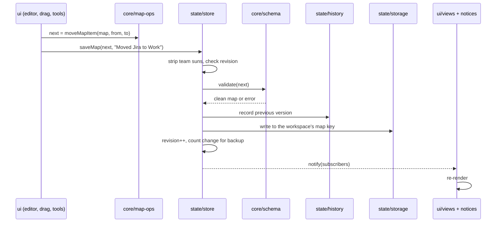

# Orbit rewrite plan (3.0.0)

Status: **planning; no app code changed yet.**

## Branch rules

- All rewrite work happens on the `rewrite` branch, starting from `main` at `d194f43` (2.2.0). That includes this plan.
- **Nothing from the rewrite goes to `main`** until the user approves the final merge.
- `main` keeps the normal rule (commit straight to `main`) for fixes to 2.2.0 only. Each fix is merged into `rewrite` the same day.
- Push the branch with `git push -u main rewrite` the first time, then `git push main rewrite`. (The remote is named `main`.)
- The change cycle still applies to each phase, on the branch: local tests, Edge on the VM, fix, docs, then commit and push to `rewrite`.
- **Every bug gets a failing test first.** Write a test that reproduces the bug, see it fail, then fix it. This applies on the branch and to fixes on `main`.

## How we test

| Approach | Where | How |
| --- | --- | --- |
| Existing behavior as the contract | Whole app | The 2.2.0 browser suites (matrix, drag, sizes, pending, features) are the acceptance tests. A phase is done when the suites it touches pass in Chromium and Edge. |
| Test-driven development | `core/` and `state/` | For each function: write a `node --test` case from what 2.2.0 does today, see it fail, write the code, then tidy it. No core or state function is merged without its tests. |
| Property-based tests (fast-check) | `core/map-ops.js`, `core/schema.js`, `state/store.js` | Generate random maps and operations and check rules that must always hold (listed in phase 2). Rules that don't fit a single example belong here. |
| State-machine model | Interaction modes (`ui/modes.js`) | The diagram under "Interaction modes" is the model. The code follows it, and its transitions are tested directly. |
| After-the-fact checks | Layout, sizing, drag visuals | The sizing (OS) and drag (DD) suites. Writing these tests first would be slow and fragile, so they are not. |

Not used: full model-based engineering tooling (SysML) or code generated from diagrams. Both are too heavy for a project of this size.

## Who does the work

The main session (the **Lead**) hands well-defined checkboxes to cheaper subagent models, which do the work and report back. Tests-first makes this safe: the Lead writes or approves the tests, a worker makes them pass without touching them, and the Lead checks the result itself. The Lead may skip delegating anything small; delegation is for work that is well defined and big enough to be worth a cold start.

### Roles

| Role | Model | Does | Never does |
| --- | --- | --- | --- |
| **Lead** (main session) | Opus | Owns the plan, architecture, and interfaces. Writes the tests first and the task cards. Reviews every diff, runs the tests itself, merges into `rewrite`. Runs the change cycle: Edge on the VM, docs, commits, pushes. Talks to the user. | Hands off decisions about architecture, data compatibility, or the user's privacy rules |
| **Builder** | Sonnet | Implements one task card in its own git worktree: writes the module so the given tests pass, runs `tsc`, `node --test`, and the named browser suite | Edits tests, changes files outside the card, commits to `rewrite` or `main`, pushes, uses the VM |
| **Helper** | Haiku | Mechanical, checkable work: rewriting the ~170 `page.evaluate` calls to `window.OrbitTest`, collecting facts for the behavior inventory, running a suite and summarizing failures, renaming, doc tidy-ups | Design choices; anything without an exact check |
| **Reviewer** | Sonnet, with fresh context | Reads a finished diff against its card and the architecture rules (layer direction, no DOM in `core/`, one writer), and lists problems | Fixes things; only reports |

### Agent definitions

All three live in `.claude/agents/` on `rewrite` and set `model`, a description, and a limited tool list:

- `orbit-builder.md` (Sonnet; Read, Edit, Write, Bash, Grep, Glob)
- `orbit-helper.md` (Haiku; same tools)
- `orbit-reviewer.md` (Sonnet; Read, Grep, Glob, read-only Bash)

The Lead launches each Builder with `isolation: "worktree"`, so parallel Builders can't touch each other's files or `rewrite`.

Each definition repeats the hard rules:

- Never read, copy, or print `tests/rdptest01.rdp` or `request-observations.md`.
- Never use the Windows VM or SSH.
- Never commit, push, or switch branches.
- Never edit files under `tests/` unless the card says so.
- Stop and report, rather than guess, when the card is unclear or a test looks wrong.

### Task card (the brief the Lead sends)

Every delegated checkbox becomes a card, using one fixed template (`.claude/agents/TASK_CARD.md`):

```
Task:        <checkbox text>  (Phase N)
Goal:        one sentence on what must be true when done
Read first:  files and plan sections to read (e.g. REWRITE_PLAN.md "Architecture", tests/behavior-2.2.md §search)
May change:  exact paths (e.g. src/core/search.js)
Must not change: tests/**, anything else
Interface:   JSDoc signatures the module must export
Done when:   these commands pass:
             npm run check
             node --test src/core/search.test.js
             (browser suite, if any)
Hard rules:  the agent file's list
Report back: in the format below
```

### Report back (what every worker returns)

```
Status:    done | blocked | partly done
Changed:   files, with one line each on what changed
Commands:  each "Done when" command, with pass/fail and the last lines of output
Deviations: anything that differs from the card, and why
Questions: anything the Lead must decide
```

### How the Lead checks a report

The Lead never accepts a report on trust:

1. **Scope:** `git diff --stat` in the worktree. Only the card's "May change" paths may appear, and `tests/` must be unchanged unless allowed.
2. **Tests:** re-run every "Done when" command; the Lead's own output is what counts.
3. **Review:** start a Reviewer on the diff for anything in `core/` or `state/`, or larger than about 200 lines.
4. **Then one of three outcomes:**
   - **Accept:** merge the worktree branch into `rewrite`.
   - **Send back:** one round of specific feedback by SendMessage to the same Builder.
   - **Take over:** the Lead finishes it after a second failed round.
5. **Record:** tick the checkbox and note its owner, e.g. `[x] … (builder, reviewed)`.

### Who owns which phase

| Phase | Lead | Delegated |
| --- | --- | --- |
| 0 Prepare | Interaction-mode check, storage fixture, baseline run | Helper: collect facts for the behavior inventory, one file at a time (the Lead writes the final inventory) |
| 1 Tooling | `build.mjs`, `window.OrbitTest` design, `jsconfig` | Helper: rewrite `page.evaluate` calls to the test hook, one test file per helper; Builder: `package.json` scripts |
| 2 Core | Schema design and every test file (tests first) | Builders in parallel, one per module: destination, templates, search, rdp, bookmarks, map-ops; Reviewer for each |
| 3 State | Store design and its tests | Builders: storage, workspaces, prefs, history; Reviewer for the store |
| 4 Services | Interfaces | Builders: one per service |
| 5–6 Screens | Screen-to-store wiring, any visual call | Builders, one screen area each; the browser suites decide |
| 7 Drag and keyboard | `ui/modes.js` and its tests | Builder: replacing the scattered flags, after the mode tests pass |
| 8 Clean-up | Cycle check, sign-off | Helper: delete old files and fix references |
| 9 Release | All of it: Edge on the VM, Windows checks, docs, merge (with the user's approval) | Nothing |

### Limits

- **At most three workers at once.** Only modules with no dependency on each other run in parallel; for example, `core/search.js` and `core/rdp.js` can run together, but `state/store.js` waits for `core/`.
- **No worker starts another worker.**
- **Track the cost.** At the end of each phase, the Lead notes in this plan how many workers ran, how many were sent back, and how many it took over. If more than about a third need taking over, it delegates less in the next phase.
- **The user still sets the pace.** No phase starts without the user's go-ahead.

## Goal

Rebuild Orbit's code so it is easier to change safely, while keeping what the user sees and their saved data the same.

- **Same:** every feature, screen, keyboard shortcut, and saved map. Orbit still opens by double-clicking `index.html`, with no install, server, or account.
- **Different:**
  - Each file is a module that names what it uses.
  - One schema defines the map format.
  - Types are checked before tests run.
  - One store holds app state and is the only place that saves.

Not in scope: new features, a new look, or a framework.

## Decisions

| Question | Choice | Why |
| --- | --- | --- |
| Language | JavaScript with JSDoc types, checked by `tsc --noEmit` (`checkJs`) | Types catch wrong fields and indices, and the source still runs as plain JavaScript |
| Modules | ES modules in `src/`, bundled by esbuild into one `orbit.js` | Chromium won't load modules from `file://`; a single bundled file works from disk |
| Bundle in git | Yes, commit `orbit.js` (as with `links-data.js`) | Double-click still works without installing anything; a test checks that the bundle matches the source |
| Map format | One schema in `src/core/schema.js` that drives validation, types, and the docs | Today four validators repeat the same rules |
| State | One store (`src/state/store.js`) that the screens subscribe to | Replaces 20 files reassigning shared globals |
| Tests | Keep the Python Playwright suites, and add a `window.OrbitTest` hook | The suites check what's on screen, so they still apply; their direct use of globals moves to the hook |
| Helpers | `serve.py`, `sync.py`, and `windows/*.ps1` stay as they are | They work and aren't part of the problem |
| Tooling | Node only for development: esbuild, TypeScript, fast-check | Users never need Node |
| Test approach | Tests first for `core/` and `state/`, property-based tests for map operations, a state-machine model for interaction modes (see "How we test") | Fast, exact tests where the logic lives; random inputs find edge cases nobody writes by hand; the mode model replaces scattered flags |

## Architecture

Arrows point from a module to what it uses. Dependencies go one way only: ui → services → state → core, and never back up. `core` touches no browser APIs, so it can be tested on its own.

```mermaid
flowchart TB
  subgraph outside["Outside the page"]
    LS[("localStorage")]
    BUNDLED["links-data.js<br/>(bundled map)"]
    TEAMFILE["team-data.js / GET /team.json<br/>(team map)"]
    SERVER["serve.py<br/>POST /api/check-links"]
    TABS["Browser tabs<br/>(window.open)"]
    RDPOUT[".rdp download /<br/>orbit-rdp:// helper"]
    FILES["Files the user picks<br/>(JSON, .rdp, bookmarks, packs)"]
  end

  subgraph app["src/app"]
    MAIN["main.js<br/>startup, wiring"]
    TESTHOOK["test-hook.js<br/>window.OrbitTest"]
  end

  subgraph ui["src/ui (DOM only)"]
    direction TB
    VIEWS["views/<br/>galaxy, system, list"]
    LAYOUT["layout/<br/>fitOrbitSizes, moon fan"]
    FIND["find/<br/>Quick find, palette"]
    MENU["menu/<br/>settings, help, about"]
    EDITOR["editor/<br/>workspace page, tree,<br/>sun/planet/moon forms"]
    TOOLS["editor/tools/<br/>history, duplicates, link check,<br/>imports, bulk RDP, presets,<br/>routines, packs, workspaces"]
    NOTICES["notices/<br/>routine offer, backup,<br/>team updates, open-all report"]
    DIALOGS["dialogs/<br/>placeholder form, quick add"]
    DRAG["drag/<br/>Edit mode, pointer drag, tray"]
    KEYS["keys/<br/>focus trap, Escape order, arrows"]
    MODES["modes.js<br/>interaction-mode state machine"]
  end

  subgraph services["src/services (side effects)"]
    OPENER["opener.js<br/>openLinks, pop-up report"]
    RDPLAUNCH["rdp-launch.js<br/>download / protocol URL"]
    SOURCES["sources.js<br/>bundled + team loading,<br/>file vs server mode"]
    LINKCHECK["link-check.js<br/>client for serve.py"]
    FILEIO["file-io.js<br/>pick, read, download JSON"]
    SCHEDULE["schedule.js<br/>due routines, backup due,<br/>team diff"]
  end

  subgraph state["src/state"]
    STORE["store.js<br/>state, saveMap(), subscribe()"]
    STORAGE["storage.js<br/>keys, read/write, migrations"]
    WS["workspaces.js<br/>active workspace, key prefix"]
    PREFS["prefs.js<br/>theme, toggles, recents,<br/>favorites, variables"]
    HISTORY["history.js<br/>versions, removal undo"]
  end

  subgraph core["src/core (pure, no DOM)"]
    SCHEMA["schema.js<br/>map, link, routine, preset,<br/>pack: types + validate"]
    DKEY["destination.js<br/>destinationKey, normalize"]
    TEMPL["templates.js<br/>{placeholders}"]
    OPS["map-ops.js<br/>moveMapItem, merge, duplicates,<br/>personalGroups, routine merge"]
    SEARCH["search.js<br/>findMatches, typo rules, tags"]
    RDPCORE["rdp.js<br/>parse .rdp, strip secrets,<br/>apply preset"]
    BOOK["bookmarks.js<br/>parse bookmark HTML"]
  end

  MAIN --> SOURCES & STORE & VIEWS & KEYS & NOTICES
  MAIN -.-> TESTHOOK
  TESTHOOK -.-> STORE & FILEIO

  VIEWS --> STORE & LAYOUT & OPENER & PREFS
  FIND --> SEARCH & STORE & OPENER & DIALOGS
  MENU --> PREFS & EDITOR & WS
  EDITOR --> STORE & OPS & SCHEMA & FILEIO & TOOLS
  TOOLS --> STORE & OPS & LINKCHECK & FILEIO & RDPCORE & BOOK & HISTORY & WS
  NOTICES --> SCHEDULE & OPENER & FILEIO
  DIALOGS --> TEMPL & STORE & PREFS
  DRAG --> OPS & STORE & MODES
  KEYS --> VIEWS & FIND & MENU & DRAG & MODES
  FIND & MENU & DIALOGS & NOTICES & VIEWS --> MODES

  OPENER --> TEMPL & DKEY & PREFS & RDPLAUNCH & TABS
  RDPLAUNCH --> RDPCORE & RDPOUT
  SOURCES --> SCHEMA & BUNDLED & TEAMFILE
  LINKCHECK --> SERVER
  FILEIO --> FILES
  SCHEDULE --> STORE & PREFS & DKEY

  STORE --> SCHEMA & OPS & HISTORY & STORAGE & WS
  HISTORY --> STORAGE
  PREFS --> STORAGE
  WS --> STORAGE
  STORAGE --> LS

  OPS --> SCHEMA & DKEY
  SEARCH --> DKEY
  SCHEMA --> TEMPL
```



### How a change flows

Every edit, drag, import, and restore takes the same path. Nothing else writes the map.



### Interaction modes

Today these modes are separate flags spread across files: `menuOverlay.hidden`, `editMode`, the drag controller, the palette, `variableDialog`, `findQuery`, and `location.hash`. Their order of precedence lives only in `handleEscape` in `keys.js`. In the rewrite they become one state machine, `ui/modes.js`, which follows this diagram. Each box runs alongside the others, and the diagram names the combinations that can't happen.

```mermaid
stateDiagram-v2
  direction LR
  [*] --> Orbit
  state Orbit {
  state "Overlay (topmost layer)" as Overlay {
    [*] --> NoOverlay
    NoOverlay --> Palette: Ctrl/Cmd+K
    NoOverlay --> Menu: cog
    NoOverlay --> PlaceholderForm: open a placeholder link
    Menu --> Palette: Ctrl/Cmd+K
    Palette --> NoOverlay: Escape / run entry
    Palette --> Menu: run entry that opens a screen
    Menu --> NoOverlay: Escape / close
    PlaceholderForm --> NoOverlay: Escape / Open / Cancel

    state Menu {
      [*] --> Settings
      Settings --> Help
      Settings --> About
      Settings --> Editor: Edit links
      Editor --> Settings: back
    }
  }
  --
  state "Mode" as Mode {
    [*] --> Browsing
    Browsing --> EditIdle: Edit mode on
    EditIdle --> Dragging: pointer down + move
    Dragging --> EditIdle: drop / Escape cancels
    EditIdle --> Browsing: Edit mode off / Escape
  }
  --
  state "View" as View {
    [*] --> Galaxy
    Galaxy --> System: open a sun
    System --> Galaxy: logo / Escape
    Galaxy --> ListView: list toggle
    ListView --> Galaxy: list toggle
  }
  --
  state "Quick find" as Find {
    [*] --> Empty
    Empty --> Filtering: type
    Filtering --> Empty: Escape / clear
  }
  }
```

Rules the model makes explicit, each tested in `ui/modes.test.js`:

- **Escape goes to the topmost active layer only:** the overlay (palette, then placeholder form, then menu), then Dragging, then Edit mode, then Quick find, then View (System → Galaxy). This is the same order as `handleEscape` today.
- **Overlays block what's underneath.** While any overlay is open, Dragging can't start, map clicks and arrow keys don't reach the map, and `/` doesn't focus Quick find.
- **Opening the menu or palette during a drag cancels the drag first.** A drag never survives a change of overlay.
- **Switching workspace or restoring a version cancels the drag.** Today `switchWorkspace` calls `cancelDrag`.
- **Only Browsing opens links and records recent links.** In Edit mode, link clicks are paused.
- **Routine offers appear only in Browsing with no overlay,** and are re-checked on returning to that state.

Phase 0 checks these rules against 2.2.0, and fixes the diagram first if 2.2.0 behaves differently.

### Rules the structure enforces

- **Core is pure.** Files in `core/` take data and return data, with no `document`, `window`, or `localStorage`.
- **One writer.** Only `store.saveMap` writes the map. Screens never change state themselves; they ask the store and re-render when notified.
- **Team suns are added at read time.** The store keeps personal and team suns apart and combines them in `store.view()`. Paths say which set they belong to (`{team: true, sun, planet, moon}`), so a raw index can no longer reach a team sun by mistake.
- **No cycles.** A lint check (esbuild metafile or `madge --circular`) fails the build if a lower layer imports a higher one.

## Old file → new home

| Today | Goes to |
| --- | --- |
| `storage.js` | `core/schema.js`, `core/destination.js`, `core/templates.js`, `state/storage.js`, `state/prefs.js` |
| `app.js` | `app/main.js`, `state/store.js` |
| `rdp.js` | `core/rdp.js`, `services/rdp-launch.js` |
| `team.js` | `services/sources.js`, `state/store.js` (combined view) |
| `favorites.js` | `state/prefs.js` (recents, favorites), `services/opener.js`, `ui/notices/` |
| `render.js` | `ui/views/`, `ui/layout/`, `core/search.js`, `ui/find/` |
| `editor.js`, `editor-page.js` | `ui/editor/` |
| `tools.js` | `core/map-ops.js` (merge, duplicates), `core/bookmarks.js`, `services/link-check.js`, `ui/editor/tools/` |
| `routines.js` | `core/map-ops.js` (merge), `services/schedule.js`, `ui/editor/tools/routines.js`, `ui/notices/` |
| `variables.js` | `core/templates.js`, `ui/dialogs/` |
| `workspaces.js` | `state/workspaces.js`, `services/schedule.js` (backup due), `ui/editor/tools/workspaces.js`, `ui/notices/` |
| `sharing.js` | `core/schema.js` (pack), `services/schedule.js` (team diff), `ui/editor/tools/packs.js`, `ui/notices/` |
| `presets.js` | `core/rdp.js` (apply), `ui/editor/tools/presets.js` |
| `menu.js` | `ui/menu/` |
| `drag.js` | `core/map-ops.js` (`moveMapItem`), `ui/drag/` |
| `palette.js` | `ui/find/palette.js` |
| `keys.js` | `ui/keys/` |
| `styles.css` | Unchanged at first; split per area once the markup is settled |

## Data the rewrite must keep

The rewrite reads all of these exactly as 2.2.0 writes them. Key names and formats stay the same, and any change goes through a numbered migration in `state/storage.js`.

- [ ] Map for each workspace: `orbit:map:v1`, plus `orbit:map:v1:<id>` for workspaces other than Main
- [ ] Removal undo and history: `orbit:undo-removal:v1[:<id>]`, `orbit:history:v1[:<id>]`
- [ ] Workspaces: `orbit:workspaces:v1`, `orbit:workspace`
- [ ] Preferences: `orbit:theme`, `orbit:animations`, `orbit:always-show-moons`, `orbit:font-size`, `orbit:rdp-launch`, `orbit:quick-bar`, `orbit:galaxy-view`, `orbit:site-icons`, `orbit:backup-reminders`
- [ ] Recents, favorites, and team-map state: `orbit:recent:v1`, `orbit:team-favorites`, `orbit:team-hidden`, `orbit:team-seen:v1`
- [ ] No other `orbit:` keys exist in 2.2.0 (checked with a grep of `*.js`); re-run that grep before the fixture is captured
- [ ] Saved values and per-day offers: `orbit:variables:v1`, `orbit:routine-offered:v1`, `orbit:backup:v1`
- [ ] Files: Export JSON, link packs (`orbit-pack-v1`), bookmark HTML, `.rdp` (UTF-8 and UTF-16)

Before any code moves, a 2.2.0 browser with all of the above filled in is saved as a fixture (`tests/fixtures/v2.2-storage.json`). Every phase must load that fixture with nothing lost.

## Plan

Each phase ends with Orbit working and its tests passing.

### Phase 0: Prepare

- [x] Create the `rewrite` branch from `main` at `d194f43` (local; 2026-11-20)
- [x] Commit this plan on `rewrite` and push the branch (`git push -u main rewrite`) (2026-11-20)
- [x] Tag `v2.2.0` on `d194f43` and push only the tag (`git push main v2.2.0`); a tag does not move `main` (2026-11-20)
- [ ] Freeze new features on `main`; only fixes go there, then into `rewrite` the same day
- [ ] Behavior inventory (`tests/behavior-2.2.md`): for each core and state function, list its inputs and outputs, edge cases, and error messages as 2.2.0 behaves today, from the code and the existing tests. This is the source for the tests written first in phases 2 and 3.
- [ ] Check the interaction-mode rules above against 2.2.0 in Chromium (including Escape order and which overlay blocks what); correct the diagram where 2.2.0 differs, and record each difference
- [ ] Capture the 2.2.0 storage fixture (every key above, two workspaces, team map, routines, presets, placeholders)
- [ ] Add `.claude/agents/orbit-builder.md`, `orbit-helper.md`, and `orbit-reviewer.md` on `rewrite` (see "Who does the work")
- [ ] Dry run: one Helper task (behavior facts for one file) through the full card → report → check loop, before any real delegation
- [ ] Add a data-compatibility check: load the fixture and compare the map, preferences, and saved values field by field
- [ ] Run every suite once on 2.2.0 and record the baseline

### Phase 1: Tooling, no behavior change

- [ ] `package.json` (development only): esbuild, TypeScript, fast-check; scripts `build`, `check`, `watch`, `test:unit` (`node --test`)
- [ ] `jsconfig.json` with `checkJs`, `strict`
- [ ] `build.mjs`: bundle `src/app/main.js` into `orbit.js` as a single script that works from `file://`, with a source map
- [ ] A test that fails if committed `orbit.js` doesn't match a fresh build
- [ ] `window.OrbitTest`: a test-only surface (`state()`, `saveMap()`, `captureDownloads()`, `reset()`), turned on by `?test=1`
- [ ] Move tests off the old globals: about 170 `page.evaluate` calls reach `groups`, `saveMap`, `copyGroups`, and `downloadJson` directly
- [ ] Replace `APP_SCRIPTS` in `tests/helpers.py` with `orbit.js` plus the data files
- [ ] Point `sync.py`, the README, and the distribution README at the new layout
- [ ] Add the task-card template (`.claude/agents/TASK_CARD.md`) that cards are copied from

### Phase 2: Core (pure logic), tests first

For each module: write its `node --test` file from the behavior inventory, see it fail, write the module, then tidy it.

- [ ] Tests first, then `core/schema.js`: one schema for map, sun, link, routine, preset, and pack; produces JSDoc types and `validate*`. Tests cover each 2.2.0 error message and dropping empty optional fields.
- [ ] Tests first, then `core/destination.js` (URL normalization, `rdp:host[:port]`)
- [ ] Tests first, then `core/templates.js` (up to five `{placeholders}`, fill, names)
- [ ] Tests first, then `core/search.js`:
  - every word must match
  - typo tolerance, including swapped letters
  - the 3+ letter contains rule on every field
  - `#tag` and `tag:` filters
  - path matches only narrow
- [ ] Tests first, then `core/rdp.js` (UTF-8 and UTF-16 parsing, secrets stripped, applying a preset keeps the link's own computer) and `core/bookmarks.js`
- [ ] Tests first, then `core/map-ops.js`: `moveMapItem`, `mergeMaps`, `mergeRoutines`, duplicates, `personalGroups`
- [ ] Property-based tests (fast-check) for `core/map-ops.js` and `core/schema.js`, with random maps of up to 10 suns, 12 planets, and 8 moons:
  - [ ] A move never loses or duplicates a link: the multiset of destination keys is unchanged
  - [ ] A move refuses team paths and never changes a team sun
  - [ ] Moving an item, then moving it back to where it came from, gives the original map
  - [ ] `mergeMaps(a, a)` equals `a`; merging adds only destinations that weren't there before
  - [ ] `mergeRoutines` never creates two routines with the same name (ignoring case)
  - [ ] Every map that passes validation also passes after export and re-import (`validate(JSON.parse(JSON.stringify(m)))` equals `m`)
  - [ ] `destinationKey` gives the same key for URLs that differ only in ways normalization ignores
- [ ] `tsc` passes with no errors in `core/`

### Phase 3: State, tests first

State tests run under `node --test` against an in-memory storage stand-in, with no browser.

- [ ] Tests first, then `state/storage.js` with the same key names, plus a migration runner (version 0 = 2.2.0, so there are no migrations yet). Tests: reads every key in the 2.2.0 fixture; a full or unavailable storage is handled the same way 2.2.0 handles it.
- [ ] Tests first, then `state/workspaces.js`: Main keeps the plain keys, others add `:<id>`; removing a workspace removes its keys and backup entry
- [ ] Tests first, then `state/prefs.js` and `state/history.js`: 20 versions kept, oldest dropped when storage is full, skipped when nothing changed, `label === false` skips
- [ ] Tests first, then `state/store.js`: state, `view()` combining personal and team suns, `saveMap(next, label)`, `subscribe()`, revision check
- [ ] Property-based tests for `state/store.js`:
  - [ ] After any sequence of saves, the stored map contains no team suns
  - [ ] Each save that changes the map raises the revision by exactly one
  - [ ] Restoring any history version gives that version's map, routines, and presets
  - [ ] A workspace switch never reads or writes another workspace's keys
- [ ] Team paths carry `team: true`; writing to a team path is a type error and a runtime refusal
- [ ] The data-compatibility check passes

### Phase 4: Services

- [ ] `services/sources.js`: bundled map, team map in file and server modes
- [ ] `services/opener.js`: open all, favorites, routines, pop-up report, placeholder values, Remote Desktop left out
- [ ] `services/rdp-launch.js`, `services/link-check.js`, `services/file-io.js`, `services/schedule.js`

### Phase 5: Views and finding

- [ ] `ui/views/`: Galaxy, System, list view; the `data-kind`/`data-sun`/`data-planet`/`data-moon` attributes stay the same
- [ ] `ui/layout/`: `fitOrbitSizes`, moon fan, Galaxy top room, System note offset
- [ ] `ui/find/`: Quick find, quick add card, palette
- [ ] Milestones 1–14 and 19 pass, along with sizing (OS01–OS06)

### Phase 6: Menu and editor

- [ ] `ui/menu/`: Settings, Help, About, workspace switch
- [ ] `ui/editor/`: workspace page, tree, sun/planet/moon forms, JSON import/export, reset, `.rdp` import
- [ ] `ui/editor/tools/`: history, duplicates, link check, bookmark and merge import, bulk RDP, presets, routines, packs, workspaces, team screens
- [ ] `ui/dialogs/`: placeholder form, quick add
- [ ] `ui/notices/`: routine offer, backup reminder, team updates, open-all report
- [ ] Milestone 18 passes, along with B03–B11, milestones 15–17, and F01–F26

### Phase 7: Drag and keyboard

- [ ] Tests first, then `ui/modes.js`: the interaction-mode state machine from the diagram. Each transition and each rule under "Interaction modes" has a `node --test` case, with no browser.
- [ ] Replace the scattered flags (`menuOverlay.hidden`, `editMode`, `variableDialog`, drag state, `findQuery`) with reads of `ui/modes.js`
- [ ] `ui/drag/`: Edit mode, pointer drag, tray, drag Undo, all driven by `ui/modes.js`
- [ ] `ui/keys/`: focus trap and arrow navigation; Escape asks `ui/modes.js` for the topmost layer instead of checking flags in order
- [ ] Browser check that overlays block what's underneath: with the menu, palette, or placeholder form open, dragging, map clicks, arrow keys, and `/` do nothing
- [ ] DD01–DD17 and K01–K08 pass

### Phase 8: Remove the old code and harden

- [ ] Delete the 20 root `*.js` app files; `index.html` loads `links-data.js`, the optional `team-data.js`, and `orbit.js`
- [ ] Import-cycle check passes; `tsc` clean across `src/`
- [ ] Split `styles.css` by area (optional, only if markup changed)
- [ ] Compare bundle size and first-render time with 2.2.0 (should be no worse)

### Phase 9: Release

- [ ] Full run of every suite in Chromium here, file and server modes
- [ ] Full run in headless Edge on the VM, both modes
- [ ] Visible-window Edge pass in the user's Remote Desktop session (also covers 2.2.0's missing pass)
- [ ] Windows checks B01, B02, B07
- [ ] Open the 2.2.0 storage fixture in Edge on the VM; nothing lost
- [ ] Docs: README (developer section: `npm run build`), HANDOFF, TEST_MATRIX, ROADMAP, this plan ticked
- [ ] `APP_VERSION` 3.0.0; release note: "nothing changes for you", plus how to go back to `v2.2.0`
- [ ] Only after the user approves: merge `rewrite` into `main`, push, tag `v3.0.0`, delete the branch

## Risks

| Risk | What we do |
| --- | --- |
| Saved maps or preferences lost | Same key names, the 2.2.0 fixture checked every phase, migrations only with a test |
| `file://` stops working | Bundle as one plain script; every phase runs the file-mode suites in Chromium and Edge |
| Tests depend on old globals | `window.OrbitTest` in phase 1, before any app code moves |
| Sizing and drag behave slightly differently | Keep the DOM structure and class names; OS and DD suites at every phase they touch |
| `main` and `rewrite` drift apart | Feature freeze; fixes to `main` are merged into `rewrite` the same day |
| The rewrite takes longer than planned | Each phase leaves a working app on the branch; we can stop after any phase and keep `main` as is |
