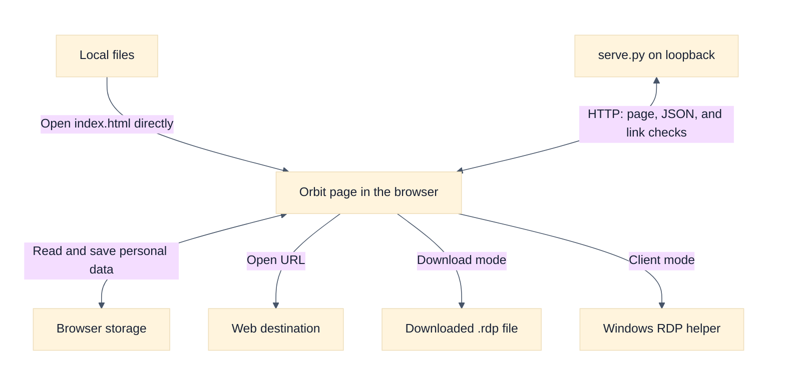
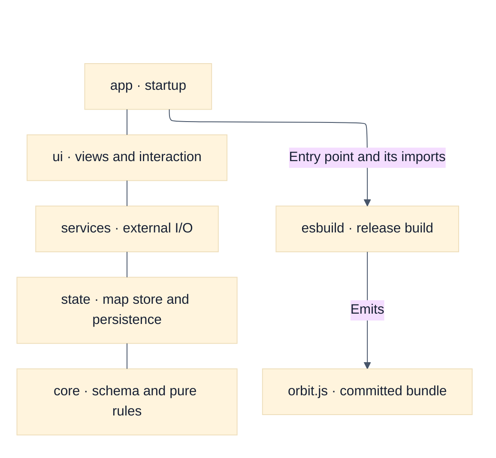
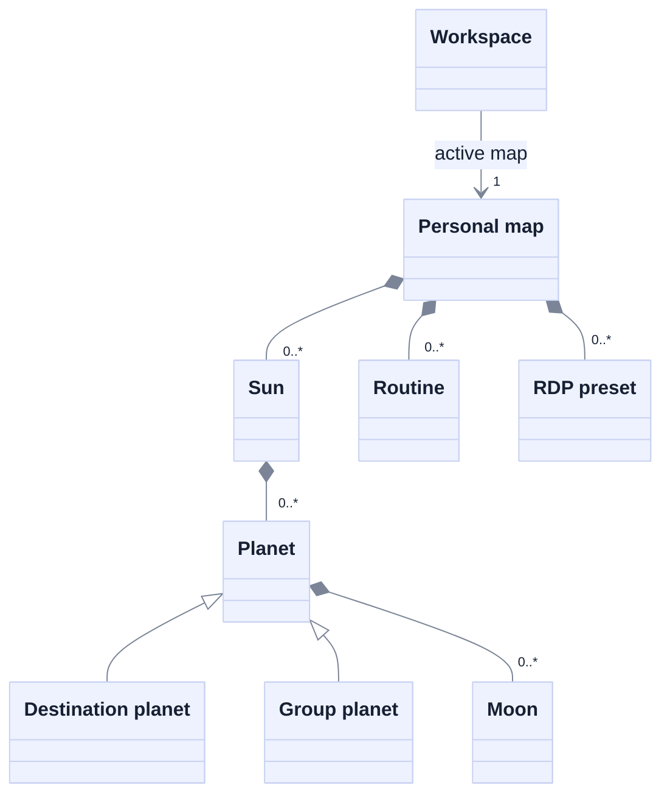
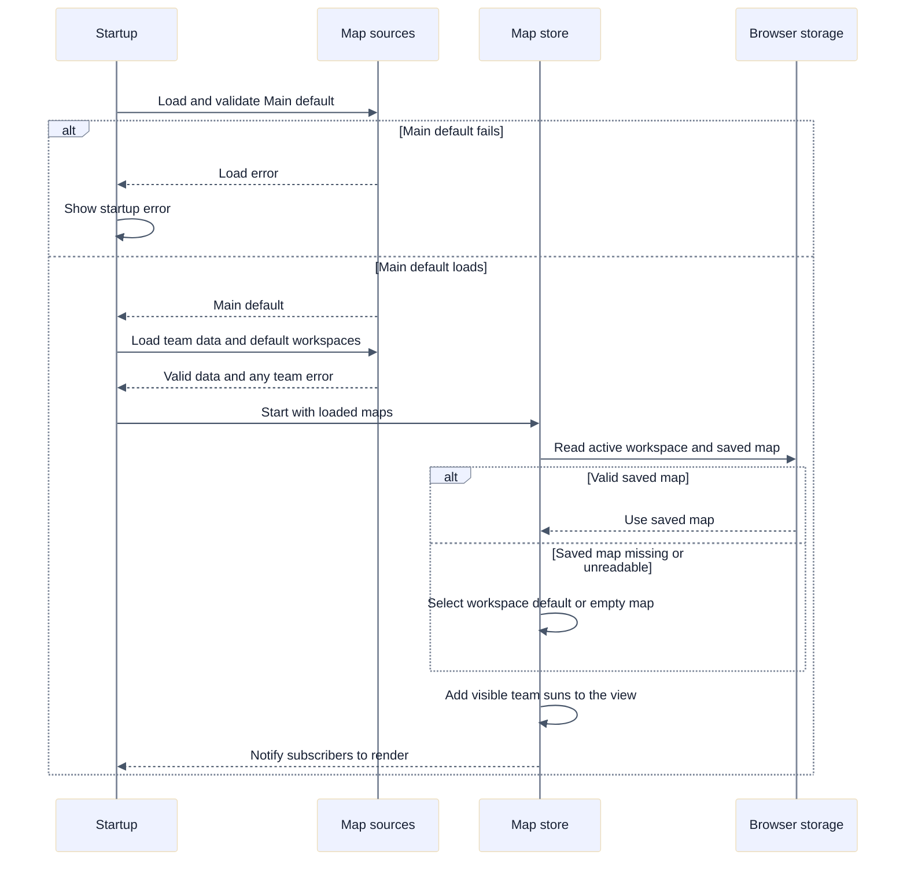
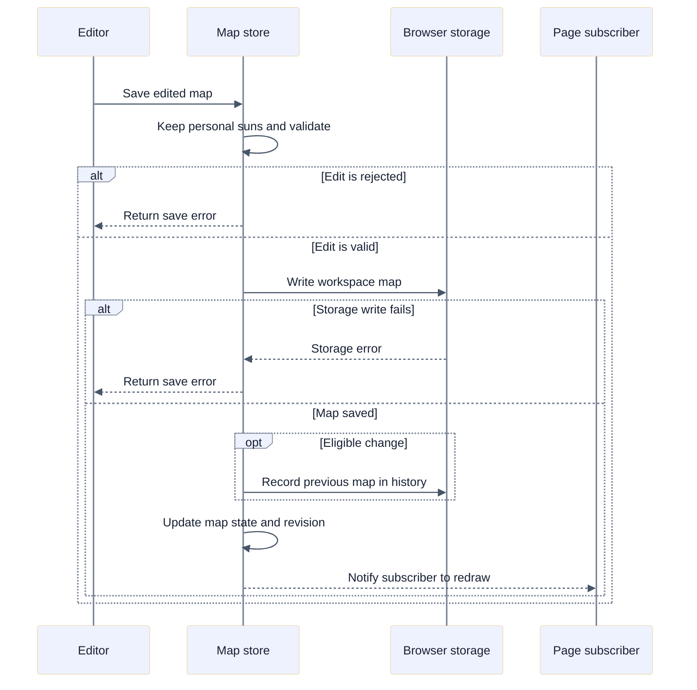

# Orbit architecture

Orbit is a browser-based link map. It runs from `index.html` on disk or through a local Python server. The browser owns personal edits, while project files supply the default maps.

Use the [architecture update prompt](architecture-update.md) when a change affects runtime behavior, source layers, the map model, or the way Orbit loads and saves data.

## Runtime and integrations

Either launch path loads the same page and committed JavaScript bundle. The local server also serves a team map when configured and handles link checks. Orbit opens web destinations in the browser. For Remote Desktop, it can download an `.rdp` file or hand off an `orbit-rdp://` URL to the installed Windows helper, which invokes Remote Desktop Connection.

The release archive includes the browser assets, generated data, Python scripts, and Windows helper. See the [page entry point](../index.html), [local server](../serve.py), [RDP launch service](../src/services/rdp-launch.js), and [release contents](RELEASING.md#what-goes-in-the-zip).

## Source layers and build

Source files may import from their own layer or any lower layer. The layer check rejects upward imports and cycles. In the diagram, the vertical connections show layer order. The build starts at `src/app/main.js` and emits `orbit.js` as a plain browser script.

See the [layer check](../scripts/check-layers.mjs) and [build script](../scripts/build.mjs).

## Map and workspace model

A workspace supplies one active personal map. Suns contain planets. A destination planet opens a website or an RDP connection. A group planet organizes its moons, which are destinations. A map can also carry routines and RDP presets. Visible team suns appear alongside the personal suns at runtime and stay out of saved personal maps.

See the [validated map types](../src/core/types.js), [schema](../src/core/schema.js), and [workspace metadata](../src/state/workspaces.js).

## Startup and map selection

Direct launch uses the generated JavaScript data. Served launch reads `links.json` for Main and uses the generated workspace list to discover default workspaces, preferring each workspace's JSON when it can be fetched. The team source is independent. Served mode tries `/team.json` before the generated team data, and a team load error leaves personal startup available. Generate the bundled data with `python3 sync.py` after editing project map files.

An unreadable saved map produces a warning. Without a valid saved map, the store uses Main's default for Main, a matching bundled default for another default workspace, or an empty map when the workspace has no bundled default. See the [source loaders](../src/services/sources.js), [startup](../src/app/start.js), [map store](../src/state/store.js), and [data generator](../sync.py).

## Saving a map edit

The page's map store owns writes. It validates the personal map and saves it under the active workspace's browser storage key. When appropriate, it records the previous personal map in history and updates the backup reminder count. The page receives the updated view through a store subscription.

The store preserves unreadable raw map data before replacing it. Optional removal undo records have their own save and recovery handling. See the [page store](../src/state/page-store.js), [save implementation](../src/state/store.js), and [store tests](../src/state/store.test.js).

## Interaction state

**Diagram pending.** Show the four concurrent parts of Orbit's interaction state: overlay, edit and drag mode, current view, and Quick Find. Include Escape precedence and the events that cancel a drag. See the [mode reducer](../src/ui/modes.js) and [mode tests](../src/ui/modes.test.js).
